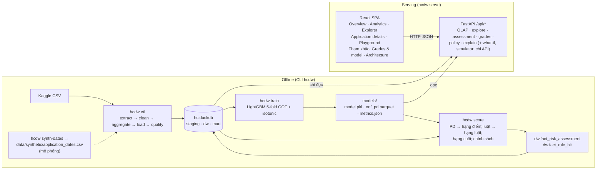

# Kiến trúc & thiết kế

Tài liệu này gom các sơ đồ thiết kế của hệ thống. Mỗi sơ đồ là một file SVG vẽ tay trong `docs/diagrams/`
(tự đổi màu theo giao diện sáng/tối). Trang **Architecture** của web app hiển thị đúng các file này và cho tải về.
Ảnh PNG độ phân giải gấp đôi cho báo cáo: `python scripts/capture_figures.py --only diagrams`
(ra `reports/figures/diagram_*.png`).

## 0. Tổng quan: offline và serving

Hệ thống chia hai phần. **Offline** dựng kho, train mô hình và chấm điểm hàng loạt. **Serving** trả lời web từ kho và mô hình đã lưu.

- `hcdw etl` mất khoảng 15 giây trên dữ liệu thật; `hcdw etl --score` chạy cả ba bước offline (thêm train + chấm điểm), khoảng 1,5 phút.
- Sau `hcdw etl` (không `--score`), hai bảng fact DSS rỗng; KPI về hạng trả NULL và API thẩm định trả 503 cho tới khi chạy `hcdw score`.
- Offline và serving dùng chung `src/dss/features.py`, `grading.py`, `rules.py` (SQL luật lấy từ `configs/settings.yaml`), nên chấm hàng loạt và chấm một hồ sơ cho cùng kết quả.
- DuckDB chỉ cho một tiến trình ghi: tắt `hcdw serve` trước khi chạy `hcdw etl` hoặc `hcdw score` (hai lệnh này ghi kho).

**Phạm vi số liệu:** mọi số tổng hợp trên web (Overview, Analytics, Explorer, Playground, Grades & model) tính trên mọi hồ sơ đã chấm (khoản vay lịch sử + hồ sơ mới); chỉ số cần kết quả trả nợ (tỷ lệ vỡ nợ, tỷ lệ của luật, AUC…) chỉ tính trên khoản vay lịch sử. Sơ đồ ở §8. Chi tiết: [kpi_definitions.md](kpi_definitions.md), [dss_design.md](dss_design.md) §7.6b.

**Trang web** (`frontend/src/components/Layout.tsx`):

| Nhóm menu | Trang | Đường dẫn | Nội dung |
|---|---|---|---|
| Menu chính | Overview | `/` | Ô waffle "Out of every 100 applications · Historical loans": khoản vay lịch sử theo quyết định × kết quả, bấm một ô để mở Explorer với nhóm đó. 5 ô KPI "All applications · N" trên mọi hồ sơ đã chấm (tỷ lệ vỡ nợ chỉ trên khoản vay lịch sử), không theo bộ lọc. Segment analysis: một ô "Group by" (13 thuộc tính, mặc định `credit_history_status`, lưu ở `?dim=`) điều khiển biểu đồ Default rate by segment và bảng Segment size. Bấm một cột thì mở Explorer với nhóm đó làm điều kiện lọc |
| Menu chính | Analytics | `/analytics` | Minh hoạ các phép OLAP (BR-03) trên một khối dữ liệu: slice (cố định một chiều ở một giá trị), dice (điều kiện trên từ hai chiều), roll-up / drill-down (lên / xuống cấp năm ↔ quý ↔ tháng, hoặc bớt / thêm chiều), pivot (đổi hàng và cột). Tab **Cube**: thanh lọc dạng chip (slice/dice); Interval Year / Quarter / Month (roll-up / drill-down cho ba biểu đồ theo thời gian); 4 biểu đồ cố định (Applications over time, Default rate over time, Grade mix over time, Default rate by segment); bảng Cube: ▲/▼ roll-up / drill-down theo phân cấp thời gian, × bỏ chiều, + thêm chiều (tối đa 2 chiều hàng, 1 chiều cột), ⇄ pivot, chọn measure, heatmap có tổng phụ. Bấm một ô hoặc một cột thì mở Explorer (drill-through). Trạng thái lưu trên URL (`?state=`). Tab **SQL queries**: 6 truy vấn mẫu (`src/sql/olap/`). Sơ đồ ở §7 |
| Menu chính | Explorer | `/explore` | Trả lời "Rủi ro đang dồn vào phân khúc nào, và chính sách nào sẽ xử lý được?". Bộ lọc dạng chip kiểu Kibana (trường · toán tử · giá trị, lưu trên URL) → chỉ số của nhóm so với mọi hồ sơ (quy mô, tỷ lệ quyết định, rủi ro còn lại, rủi ro đã chặn, kết quả nhóm thẩm định thêm) → danh sách hồ sơ phân trang, chọn cột; bấm dòng để mở Application details |
| Menu chính | Application details | `/applications-details` | Một hồ sơ: ba hạng, đề xuất, hạn mức, SHAP, luật vi phạm, thông tin khách |
| Menu chính | Playground | `/playground` | Mô phỏng chính sách trên mọi hồ sơ đã chấm (tỷ lệ vỡ nợ trên khoản vay lịch sử). Preset Approve C, Loosen, Tighten, Rules off và nút Reset; 5 ô KPI chính (Approval rate, Approved credit, Default rate (approved), Credit at risk (approved), Manual review rate), mỗi ô ghi giá trị hiện hành → mô phỏng; Decision mix (thanh hiện hành so với mô phỏng) kèm Who moves; bảng Policy by grade (ngưỡng PD nhập theo bước 0,5 điểm %, quyết định, hạn mức; cột Loans, Default rate, Credit at risk); thẻ Rules (bật/tắt từng luật; đổi ngưỡng của BR-RF-01, BR-RF-02, BR-RF-03, BR-RF-05; BR-SEG-01 và BR-RF-04 chỉ bật/tắt). Giá trị "hiện hành" luôn là chính sách đang cấu hình (có luật) |
| Chân sidebar (tham khảo) | Grades & model | `/grades` | Chọn phạm vi All applications / Historical loans / New applications (mặc định All); 2 ô chỉ số (Downgraded by rules, Model AUC); bảng Grade scale (chọn Score / Rule / Final); What drives the score; PD so với tỷ lệ vỡ nợ thực tế |
| Chân sidebar (tham khảo) | Architecture | `/architecture` | Các sơ đồ thiết kế |

**Endpoint DSS và KPI** (hợp đồng chi tiết: [dss_design.md](dss_design.md) §7 và §7.5):

| Endpoint | Dùng cho | Trang web |
|---|---|---|
| `GET /api/meta` | Danh sách chiều, measure, giá trị của từng chiều, phân cấp thời gian, thông tin kho | Mọi trang (tải một lần khi mở app) |
| `GET /api/kpis/summary` | 5 KPI trên mọi hồ sơ đã chấm (tỷ lệ vỡ nợ chỉ trên khoản vay lịch sử), bỏ qua bộ lọc (`mart.kpi_portfolio_summary`) | Overview |
| `GET /api/kpis` | KPI theo bộ lọc, có `total_credit` và `expected_loss` | Chỉ API |
| `GET /api/by/{dim}` | Số hồ sơ, tỷ lệ vỡ nợ và `total_credit` theo chiều (có cả `application_year`, `application_quarter`, `application_month`, xếp theo thời gian) | Overview (Segment analysis, không bộ lọc) |
| `POST /api/analytics/cube` | Khối OLAP: điều kiện slice/dice (cùng mô hình điều kiện với Explorer), tối đa 2 chiều hàng và 1 chiều cột, một measure; GROUPING SETS trả cả tổng phụ và tổng chung | Analytics |
| `GET /api/olap`, `GET /api/olap/{name}` | Danh sách và kết quả các truy vấn SQL mẫu (`src/sql/olap/`) | Analytics (tab SQL queries) |
| `GET /api/pivot` | Bảng pivot theo bộ lọc | Chỉ API |
| `GET /api/explore/fields` | Danh sách trường lọc: nhóm, kiểu (`category`, `number`, `boolean`, `date`), toán tử, giá trị hoặc khoảng min–max; có ngày nộp / ngày kết quả, tháng / quý / năm nộp và số tháng đến kết quả | Explorer |
| `POST /api/explore/metrics` | Chỉ số của nhóm và của mọi hồ sơ (gồm số hồ sơ theo quyết định × kết quả) | Explorer; Overview (ô waffle, nhóm rỗng) |
| `POST /api/explore/applications` | Danh sách hồ sơ của nhóm: phân trang, sắp xếp, chọn cột | Explorer |
| `GET /api/cross` | Như trên, theo hai chiều | Chỉ API |
| `GET /api/assessment/{id}` | PD, ba hạng, đề xuất, hạn mức, SHAP, luật vi phạm, `profile` của hồ sơ (gồm `application_date`, `outcome_date`, `months_to_outcome`) | Application details |
| `GET /api/grades` | Phân bố hạng, tỷ lệ vỡ nợ theo hạng, % bị hạ hạng, chính sách hiện hành; `?scope=all` (mặc định) / `train` / `test` | Grades & model; Playground (ngưỡng và chính sách hiện hành, làm điểm xuất phát cho mô phỏng) |
| `GET /api/rules` | Danh mục luật theo thứ tự cấu hình, kèm thống kê trên khoản vay lịch sử và ngưỡng sửa được (`param`) | Playground (thẻ Rules) |
| `POST /api/policy/simulate` | Xếp hạng lại mọi hồ sơ đã chấm theo ngưỡng / luật / chính sách mới (tỷ lệ vỡ nợ chỉ trên khoản vay lịch sử); KPI của nhóm được duyệt; `transitions` (nhóm hồ sơ đổi hạng / quyết định so với chính sách hiện hành); `rules` | Playground |
| `GET /api/policy/pd-distribution` | Phân bố PD của khoản vay lịch sử theo khoảng 0,5 điểm % (cộng khoảng tràn ≥ 30%) | Chỉ API (cho phân tích) |
| `GET /api/explain/global` | AUC, bảng hiệu chỉnh, SHAP toàn cục (trên khoản vay lịch sử) | Grades & model |
| `POST /api/assessment/what-if` | Sửa vài trường của một hồ sơ rồi chấm lại | Chỉ API |
| `GET /api/simulator/options`, `POST /api/simulator/score` | Chấm một hồ sơ nhập tay | Chỉ API |
| `GET /api/health`, `GET /api/hierarchy`, `GET /api/score-curve`, `GET /api/dti-by-outcome`, `GET /api/bureau/kpis`, `GET /api/bureau/trend`, `GET /api/bureau/by-type` | Kiểm tra sống; phân cấp; đường điểm; DTI theo kết quả; phân tích chéo sang fact bureau (drill-across) | Chỉ API |

## 1. Kiến trúc hệ thống (C4 – container)

Người dùng (quản lý rủi ro, chuyên viên tín dụng) dùng web dashboard; API trả lời từ kho DuckDB và mô hình DSS; ETL dựng kho từ file Kaggle.

- Kho là một file DuckDB: lưu theo cột, xử lý vector hoá, không cần chạy server. Nạp lại toàn bộ 2,7 GB CSV mất khoảng 15 giây; `hcdw etl --score` (thêm train + chấm điểm) khoảng 1,5 phút.
- Ngoài 8 file Kaggle còn một nguồn **mô phỏng**: `data/synthetic/application_dates.csv` (ngày nộp hồ sơ, ngày có kết quả), sinh bằng `hcdw synth-dates`.
- Chỉ API được đọc kho. Trình duyệt không gửi SQL: tên chiều và chỉ số được kiểm tra theo danh sách cho phép, giá trị lọc đi qua tham số.
- MotherDuck là bản sao trên cloud (không bắt buộc) để cả nhóm truy vấn mà không phải tải dữ liệu.

File: [`docs/diagrams/01_system_architecture.svg`](diagrams/01_system_architecture.svg)

## 2. Quy trình ETL

Bảy bước ghi vào file tạm `hc.duckdb.building`; chỉ khi mọi bước chạy xong và mọi kiểm tra chất lượng đạt mới thay kho đang dùng.

- Extract đọc mọi cột dạng chuỗi rồi `TRY_CAST` về kiểu khai báo, nên một giá trị lỗi không làm hỏng cả lần nạp 27 triệu dòng.
- Quy tắc làm sạch R1–R10 viết bằng pandas (dễ đọc, có unit test); phần gộp nặng viết bằng SQL (nhanh).
- Cổng chất lượng: 50 kiểm tra, gồm khoá chính, khoá ngoại, đủ số dòng, đối soát tổng tiền giữa staging và fact, kiểm tra nguồn ngày mô phỏng, và các kiểm tra nhất quán của bảng DSS (hạng khớp PD, hạng cuối không tốt hơn hạng điểm...). Khi chạy ETL, bảng DSS còn rỗng nên các kiểm tra DSS đạt mặc nhiên; `hcdw score` chạy lại cả bộ sau khi chấm. Nếu có kiểm tra không đạt, ETL dừng trước bước hoán đổi: xoá file tạm `hc.duckdb.building`, giữ nguyên kho đang dùng, vẫn ghi `dq_report.json` và thoát với mã 1.
- Với `--score`, sau bước hoán đổi kho, ETL chạy tiếp `hcdw train` rồi `hcdw score`.

File: [`docs/diagrams/02_etl_pipeline.svg`](diagrams/02_etl_pipeline.svg)

## 3. Star schema (fact constellation)

Hai bảng fact chính (hồ sơ vay, khoản vay bureau) dùng chung dimension khách hàng và thời gian, nên có thể phân tích chéo (drill-across) từ hồ sơ vay sang khoản vay bureau.

- Grain: một hồ sơ vay (`SK_ID_CURR`) và một khoản tín dụng bureau (`SK_ID_BUREAU`).
- `dim_credit_history` là mini-dimension: hàng chục triệu dòng lịch sử gộp thành khoảng 200 hồ sơ đã chia bucket.
- `dim_bureau_category` là junk dimension. `dim_time` là role-playing dimension trên cả hai fact: ngày nộp / ngày có kết quả (`application_date_key`, `outcome_date_key`, ngày mô phỏng) trên fact hồ sơ vay, ngày mở / ngày tất toán trên fact bureau.
- Phần DSS: `dim_risk_grade`, `dim_rule`, `fact_risk_assessment` (1:1 với hồ sơ vay) và `fact_rule_hit` (một dòng mỗi luật vi phạm). Mô tả chi tiết ở [star_schema.md](star_schema.md) §7.

File: [`docs/diagrams/03_star_schema.svg`](diagrams/03_star_schema.svg)

## 4. Data lineage

Mỗi bảng trong kho đến từ đâu: từ file Kaggle qua staging, bảng gộp, tới bảng của star schema.

- Các bảng con (1..N dòng mỗi khách) được gộp thành một hồ sơ tín dụng mỗi khách trước khi vào dimension.
- Nguồn mô phỏng `application_dates.csv` → `staging.application_dates` → `staging.application_calendar` (độ lệch ngày so với ngày mốc) → `dim_time` và khoá ngày nộp / ngày có kết quả của `fact_loan_application`. Ngày mở / tất toán của khoản bureau cũng tính lệch theo ngày nộp hồ sơ.
- Bảng DSS: `dim_risk_grade`, `dim_rule` lấy từ `configs/settings.yaml`; `fact_risk_assessment`, `fact_rule_hit` do `hcdw score` ghi từ mô hình và `mart.v_application_wide`.
- `fact_bureau_credit` giữ grain của bureau và nối về `dim_customer` để phân tích chéo.

File: [`docs/diagrams/04_data_lineage.svg`](diagrams/04_data_lineage.svg)

## 5. Luồng một truy vấn OLAP

Điều gì xảy ra khi người dùng đổi khối dữ liệu trên trang Analytics: trạng thái trên URL → `POST /api/analytics/cube` → kiểm tra theo danh sách cho phép → một câu SQL GROUPING SETS → vẽ lại.

- Người dùng thêm một chip lọc (slice/dice) hoặc bấm Interval, ▲/▼, ×, + hay ⇄. Trạng thái (điều kiện, interval, hàng, cột, measure) ghi vào `?state=` nên chia sẻ được bằng link; trang gửi song song 5 yêu cầu (4 biểu đồ + bảng Cube).
- API kiểm tra body bằng pydantic (sai kiểu → 422), rồi `cube.py` kiểm tra tên chiều và measure theo danh sách cho phép, tối đa 2 chiều hàng và 1 chiều cột, không lặp chiều (sai → 400). Giá trị lọc đi qua tham số.
- Một câu SQL `WHERE application_id IN (nhóm) GROUP BY GROUPING SETS (...)` trên `mart.v_application_wide` trả ô, tổng phụ và tổng chung (null = mức tổng, "(missing)" = giá trị NULL thật). Bấm một ô thì mở Explorer với nhóm đó (drill-through).
- Cube không cache; các truy vấn khác của API (Overview, Grades, Rules, SQL queries, Explorer `book`) được nhớ bằng `lru_cache`, vì kho là snapshot tĩnh cho tới lần ETL sau. Mỗi truy vấn cube mất khoảng 15–60 ms trên 356 nghìn hồ sơ.

File: [`docs/diagrams/05_request_flow.svg`](diagrams/05_request_flow.svg)

## 6. Luồng hệ hỗ trợ quyết định (DSS)

DSS xếp mỗi hồ sơ vào thang A–E và gắn một chính sách, kèm giải thích.

| Bước | Nội dung |
|---|---|
| Hạng điểm | Mô hình LightGBM cho PD đã hiệu chỉnh (isotonic), quy về A–E theo ngưỡng 1% / 7% / 13% / 20% |
| Hạng luật | Hạng xấu nhất trong các luật vi phạm: luật phân khúc `BR-SEG-01` và luật nghiệp vụ `BR-RF-01..05` |
| Hạng cuối | Hạng xấu hơn trong hai hạng. Luật chỉ hạ hạng, không nâng |
| Chính sách | A, B: Approve · C, D: Manual review · E: Reject; hạn mức 8/6/4/3/0 lần thu nhập |
| Giải thích | SHAP 3–5 yếu tố mỗi chiều, danh sách luật vi phạm, câu tóm tắt hạ hạng |

- Mô hình train trên kho (`mart.v_application_wide`), không đọc file gốc, nên dashboard và mô hình thấy cùng một dữ liệu.
- Hồ sơ train dùng PD out-of-fold, nên thang hạng không đẹp giả do rò rỉ nhãn.
- Chi tiết thiết kế và số liệu thực đo: [dss_design.md](dss_design.md) (§9).

File: [`docs/diagrams/06_dss_flow.svg`](diagrams/06_dss_flow.svg)

## 7. Analytics: OLAP → giao diện

Mỗi phép OLAP ứng với một nút trên trang Analytics, một trường trong body của `POST /api/analytics/cube` và một phần của câu SQL.

| Phép OLAP | Trên giao diện | Trường trong yêu cầu | SQL |
|---|---|---|---|
| Slice / dice | Chip trên thanh lọc | `conditions[]` | `WHERE … IN (nhóm)`, giá trị qua tham số |
| Roll-up / drill-down | Interval Year / Quarter / Month; ▲/▼ trên chip chiều (năm → quý → tháng); × bỏ chiều; + thêm chiều | các mức trong `rows[]` | Tiền tố của GROUPING SETS = tổng phụ |
| Pivot | ⇄ | đổi `rows` và `cols` | — |
| Measure | Ô chọn Measure | `measure` (danh sách `MEASURES`; Default rate chỉ trên khoản vay lịch sử) | — |
| Drill-through | Bấm một ô hoặc một cột | — | Mở Explorer với các điều kiện tương ứng |

- 4 biểu đồ cố định: Applications over time (số hồ sơ theo quyết định), Default rate over time, Grade mix over time (tỷ trọng hạng cuối, 100%), Default rate by segment (chọn chiều bằng "Split by").
- Tab SQL queries: 6 truy vấn mẫu (01 Roll-up, 02 Cube, 03 Drill-down, 04 Slice, dice & pivot, 05 Time roll-up trên bureau, 06 Ranking) qua `GET /api/olap/{name}`.
- Code: `frontend/src/pages/Analytics.tsx`, `src/hcdw/api/cube.py`.

File: [`docs/diagrams/07_analytics_olap.svg`](diagrams/07_analytics_olap.svg)

## 8. Phạm vi KPI

Hai tập hồ sơ: mọi hồ sơ đã chấm (356.255) = khoản vay lịch sử (307.511, tập train, có kết quả trả nợ) + hồ sơ mới (48.744, tập test, chưa có kết quả).

- Tính trên mọi hồ sơ đã chấm: số hồ sơ, tỷ lệ quyết định, dư nợ cấp mới (Total credit), dư nợ chịu rủi ro (Credit at risk), cơ cấu hạng, PD trung bình, SM-5, cột "Loans hit" của luật.
- Chỉ tính trên khoản vay lịch sử: tỷ lệ vỡ nợ, tỷ lệ vỡ nợ của nhóm được duyệt (SM-2), tỷ lệ của luật, AUC, phân bố kết quả và ô waffle.
- Dòng thời gian: khoản vay lịch sử nộp từ 2015-06 đến 2017-05, kết quả muộn nhất 2018-05-17; hồ sơ mới nộp từ 2017-05 đến 2018-05-17 và chưa có kết quả, nên biểu đồ Default rate over time dừng ở khoảng 2017-05.
- Theo trang: Overview (waffle: khoản vay lịch sử; ô KPI: mọi hồ sơ, tỷ lệ vỡ nợ trên khoản vay lịch sử), Analytics và Explorer (mọi hồ sơ; measure Default rate chỉ trên khoản vay lịch sử), Playground (KPI của nhóm được duyệt trong mọi hồ sơ; tỷ lệ vỡ nợ trên khoản vay lịch sử), Grades & model (chọn phạm vi, mặc định All applications).
- Định nghĩa từng KPI: [kpi_definitions.md](kpi_definitions.md); quy tắc phạm vi: [dss_design.md](dss_design.md) §7.6b.

File: [`docs/diagrams/08_kpi_scope.svg`](diagrams/08_kpi_scope.svg)

## Công nghệ

| Tầng | Công nghệ |
|---|---|
| Lưu trữ & OLAP | DuckDB (file local) · MotherDuck (bản cloud, không bắt buộc) |
| ETL | Python 3.11+ · pandas · DuckDB SQL · CLI Typer (`hcdw`) |
| Backend | FastAPI · Uvicorn · SQL có kiểm tra tên, giá trị qua tham số; `lru_cache` cho truy vấn của Overview, Grades, Rules, SQL queries và Explorer `book` (cube không cache) |
| Frontend | React 18 · TypeScript · Tailwind CSS (design system màu teal) · Recharts · sơ đồ SVG vẽ tay |
| Hỗ trợ quyết định | LightGBM (5-fold OOF) · scikit-learn (isotonic) · SHAP từ LightGBM · luật trong `configs/settings.yaml` |
| Kiểm thử | pytest (ETL, API, DSS) · báo cáo chất lượng mỗi lần chạy |
