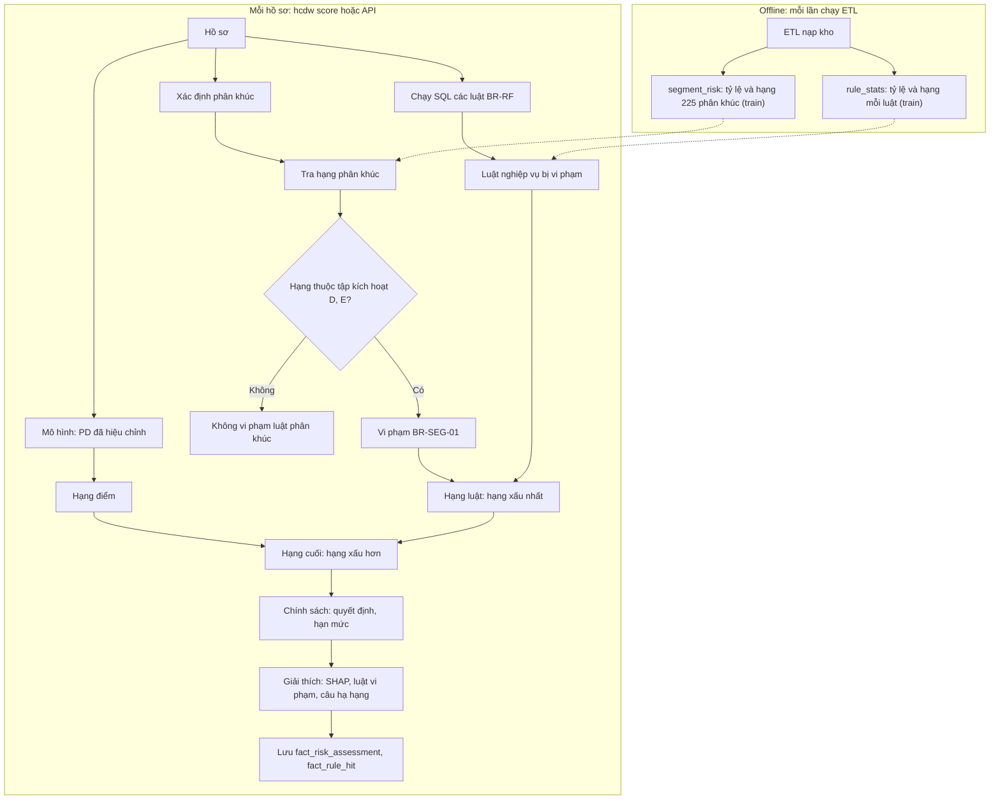

# Thiết kế DSS thẩm định A–E

Thiết kế DSS: luật, chính sách, schema, hợp đồng mô hình và API. Kết quả đo trên dữ liệu thật và chi tiết triển khai nằm ở [mục 9](#9-kết-quả-thực-đo). Nghiệp vụ lấy từ [business_requirements.md](business_requirements.md) (mục 4.1–4.3, BR-04..BR-09).

**Nguồn số liệu.** Số liệu được tính bằng DuckDB chỉ đọc trên `data/warehouse/hc.duckdb`. Số liệu ở mục 0–3 chỉ dùng khoản vay lịch sử (hồ sơ train, `is_train`): 307.511 hồ sơ, tỷ lệ vỡ nợ chung 8,07%. Mục 7 và 9 ghi thêm số trên mọi hồ sơ (356.255). Những chỗ khác với [data_profiling.md](data_profiling.md) được ghi rõ.

**Quy ước.**
- Số trong văn bản viết kiểu Việt (15,10%; 19.056). Số trong SQL, YAML và JSON viết kiểu code (0.151).
- Thang hạng `[0.01, 0.07, 0.13, 0.20]` tính cận dưới: A < 1% ≤ B < 7% ≤ C < 13% ≤ D < 20% ≤ E.

## 0. Tóm tắt quyết định

| Hạng mục | Quyết định |
|---|---|
| Thuộc tính phân khúc | `credit_history_status` (3 nhóm) × nhóm tuổi (5 nhóm, gộp 55+) × nhóm thu nhập (4 nhóm + `Other`) × `region_rating_client` (1–3). Tổng 225 phân khúc |
| Phân khúc nhỏ | Phân khúc có n < 500 lấy tỷ lệ của cấp cha, theo thứ tự: cấp 4 (đủ 4 thuộc tính) → cấp 3 (bỏ vùng) → cấp 2 (bỏ thêm thu nhập) → cấp 1 (chỉ còn lịch sử tín dụng) → cấp 0 (toàn bộ khoản vay lịch sử) |
| Hạng kích hoạt luật phân khúc | {D, E}: 20.320 hồ sơ train bị gắn cờ (6,61%), 3.031 hồ sơ test (6,22%) |
| Luật nghiệp vụ giữ lại | BR-RF-01 (D), BR-RF-02 (C), BR-RF-03 (C), BR-RF-04 (D), BR-RF-05 (D) |
| Không dùng | Luật DTI: DTI gần như không phân biệt được rủi ro ([data_profiling.md](data_profiling.md)), nên chỉ là chỉ số tham khảo (SM-5). Không có luật ứng viên nào ra hạng A hoặc B |
| Tỷ lệ hồ sơ có hạng luật | 24,93% hồ sơ train, 24,43% hồ sơ test |
| Chính sách | A: Duyệt (Approve), tối đa 8,0 lần thu nhập. B: Duyệt, 6,0. C: Thẩm định thêm (Manual review), 4,0. D: Thẩm định thêm, 3,0. E: Từ chối (Reject), 0 |

**Quyết định thiết kế khác:**

| # | Quyết định |
|---|---|
| 1 | Giữ luật BR-RF-05 |
| 2 | Hạn mức A/B/C/D/E = 8/6/4/3/0 lần thu nhập (căn cứ ở mục 3). Thử hạn mức khác bằng mô phỏng chính sách trên Playground |
| 3 | Mọi chữ hiển thị trên web viết **tiếng Anh**, thống nhất trên mọi trang: `FEATURE_LABELS`, `label` của luật, nhãn hạng, `decision_label`, câu `summary`, nhãn `DIMENSIONS`/`MEASURES`. Văn bản tài liệu vẫn viết tiếng Việt |
| 4 | Simulator nhập tay (chỉ API) chỉ bắt buộc `amt_income` và `amt_credit`; mọi trường khác có thể để trống |
| 5 | Mốc kiểm tra cho 3 nhóm `credit_history_status` lấy theo định nghĩa của kho (chỉ tính khoản `Active`): No bureau 10,12%, Clean history 7,62%, Current overdue **16,11%** |

## Khái niệm luật

Phần này giải thích luật là gì và chạy thế nào. Các con số chi tiết nằm ở mục 1–3.

### Định nghĩa

- **Luật** là một điều kiện có mã, được kiểm tra trên một hồ sơ vay.
- Nếu hồ sơ thoả điều kiện thì hồ sơ **vi phạm** luật đó.
- Mỗi luật có một **tỷ lệ rủi ro**. Đó là tỷ lệ vỡ nợ lịch sử của các hồ sơ train vi phạm luật.
- Tỷ lệ rủi ro được quy về hạng theo đúng thang A–E của hạng điểm.

Mọi luật đều có cấu trúc chung như sau:

| Thành phần | Ý nghĩa | Ví dụ (BR-RF-02) |
|---|---|---|
| Mã | Tên ngắn, cố định, dùng để giải thích và thống kê | `BR-RF-02` |
| Nhóm | `segment` (luật phân khúc) hoặc `business` (luật nghiệp vụ) | `business` |
| Điều kiện | Biểu thức đúng/sai trên dữ liệu của hồ sơ | `late_payment_ratio > 0.2` |
| Nhóm vi phạm | Các hồ sơ train thoả điều kiện | 37.462 hồ sơ |
| Tỷ lệ rủi ro | Tỷ lệ vỡ nợ của nhóm vi phạm | 11,99% |
| Hạng | Tỷ lệ rủi ro quy về thang A–E | C |
| Trường dữ liệu cần | Các cột mà điều kiện đọc. Thiếu cột thì luật không tính được | `late_payment_ratio` |

### Ý tưởng

- **Mô hình** chấm từng cá nhân, nhưng chuyên viên khó kiểm tra lại cách mô hình chấm.
- **Luật** ghi lại kinh nghiệm nghiệp vụ và lịch sử vỡ nợ của từng nhóm khách. Mỗi luật có mã, điều kiện và tỷ lệ rõ ràng, nên chuyên viên đọc và kiểm tra được.
- Luật **chỉ hạ hạng, không bao giờ nâng hạng**. Luật chỉ có tác dụng khi hồ sơ vi phạm nó.
- Lý do: không phân khúc nào có tỷ lệ vỡ nợ dưới 1%; thấp nhất là 2,99%, hạng B. Nếu hạng phân khúc luôn được gộp vào hạng cuối, không hồ sơ nào đạt được hạng A. Ngoài ra, một phân khúc "tốt" có thể che mất một điểm cá nhân xấu.

### Thiết kế

| | Luật phân khúc | Luật nghiệp vụ |
|---|---|---|
| Điều kiện dựa trên | Hồ sơ thuộc phân khúc nào (4 thuộc tính ổn định) | Hành vi tín dụng trong quá khứ |
| Thế nào là vi phạm | Hạng của phân khúc nằm trong tập kích hoạt {D, E} | Biểu thức SQL của luật đúng |
| Tỷ lệ rủi ro lấy từ | Tỷ lệ vỡ nợ của chính phân khúc đó (`mart.segment_risk`) | Tỷ lệ vỡ nợ của mọi hồ sơ vi phạm luật (`mart.rule_stats`) |
| Số luật | 1 mã (`BR-SEG-01`). Tỷ lệ và hạng thay đổi theo phân khúc | 5 mã (`BR-RF-01..05`). Mỗi mã có một tỷ lệ cố định |
| Ví dụ | "Không có bureau \| 25-34 \| Working \| Vùng 3": 22,78% → E | `late_payment_ratio > 0.2`: 11,99% → C |

**(a) Phân khúc là gì.** Phân khúc là tổ hợp giá trị của 4 thuộc tính dưới đây. Tổng cộng có 3 × 5 × 5 × 3 = 225 phân khúc.

| Thuộc tính | Các nhóm |
|---|---|
| Lịch sử tín dụng (`credit_history_status`) | No bureau, Clean history, Current overdue |
| Nhóm tuổi (`age_band`) | 18-24, 25-34, 35-44, 45-54, 55+ |
| Nhóm thu nhập (`income_group`) | Working, Commercial associate, Pensioner, State servant, Other |
| Hạng vùng (`region_rating_client`) | 1, 2, 3 |

Ví dụ với hồ sơ `100690`:
- Hồ sơ không có dữ liệu bureau, 33 tuổi, người làm công, sống ở vùng 3.
- Khoá phân khúc là `No bureau|25-34|Working|3`.
- Phân khúc có 1.387 hồ sơ train, tỷ lệ vỡ nợ 22,78%, hạng E.

**(b) Tập kích hoạt.**
- Mỗi hồ sơ thuộc đúng một phân khúc, và mỗi phân khúc đều có một hạng.
- Nếu mọi hạng phân khúc đều được tính, luật sẽ "vi phạm" với mọi hồ sơ.
- Vì vậy **tập kích hoạt** quy định hạng phân khúc nào mới bị coi là vi phạm.

| Tập kích hoạt | Hồ sơ train bị gắn cờ | Nhận xét |
|---|---:|---|
| {E} | 0,71% | Quá ít, luật gần như không có tác dụng |
| **{D, E} (chọn)** | 6,61% | Chỉ gắn cờ các phân khúc rủi ro cao rõ rệt (vỡ nợ 15,12%) |
| {C, D, E} | 62,3% | Lấn át hạng điểm, vì hạng C chỉ là rủi ro vừa phải |

**(c) Phân khúc nhỏ.**
- Phân khúc có dưới 500 hồ sơ train thì tỷ lệ không đáng tin. Khi đó hệ thống lấy tỷ lệ của **cấp cha**.
- Thứ tự lùi cấp: cấp 4 (đủ 4 thuộc tính) → cấp 3 (bỏ vùng) → cấp 2 (bỏ thêm thu nhập) → cấp 1 (chỉ còn lịch sử tín dụng) → cấp 0 (toàn bộ khoản vay lịch sử). Hệ thống dùng cấp đầu tiên có từ 500 hồ sơ trở lên; cấp 0 luôn dùng được.
- Ví dụ: `Current overdue|25-34|Working|2` chỉ có 403 hồ sơ.
  - Bỏ vùng, được nhóm `Current overdue|25-34|Working|*` có 527 hồ sơ.
  - Nhóm này đủ 500 hồ sơ, tỷ lệ vỡ nợ 23,53%, nên phân khúc nhận hạng E.

**Luật nghiệp vụ** (chi tiết ở mục 2):

| Mã | Điều kiện | Tỷ lệ rủi ro | Hạng |
|---|---|---:|:---:|
| BR-RF-01 | `prev_approval_rate < 0.5` | 15,10% | D |
| BR-RF-02 | `late_payment_ratio > 0.2` | 11,99% | C |
| BR-RF-03 | `max_dpd_days > 90` | 9,83% | C |
| BR-RF-04 | `has_current_overdue` | 16,11% | D |
| BR-RF-05 | `late_payment_ratio > 0.5` | 16,44% | D |

### Vai trò

- **Hạng luật** là hạng xấu nhất trong các luật mà hồ sơ vi phạm. Hồ sơ không vi phạm luật nào thì không có hạng luật.
- **Hạng cuối** là hạng xấu hơn giữa hạng điểm và hạng luật. Hạng cuối quyết định chính sách: quyết định và hạn mức.
- **Chuyên viên thẩm định** thấy những gì:
  - danh sách luật vi phạm, mỗi luật có mã, nhóm, tỷ lệ và hạng;
  - câu tóm tắt (hiển thị tiếng Anh, mẫu ở mục 7.1), ví dụ "Downgraded from C to E by segment rule BR-SEG-01." hoặc "Final grade equals score grade (no rule violated)."
- **Phân tích danh mục:** phân khúc và hạng là các chiều OLAP. Chỉ số phụ SM-1 cho biết bao nhiêu % hồ sơ bị luật hạ hạng.
- **Mô phỏng chính sách (Q5):** tỷ lệ của từng lần vi phạm đã được lưu, nên khi đổi ngưỡng chỉ cần xếp hạng lại, không cần chạy lại mô hình.

| Vai trò | Yêu cầu |
|---|---|
| Tính hạng luật từ các luật vi phạm | BR-05 |
| Gộp với hạng điểm thành hạng cuối, gắn chính sách | BR-06 |
| Giải thích: luật vi phạm và mức bị hạ hạng | BR-08 |
| Mô phỏng chính sách cho cả danh mục (trang Playground) | BR-09 |

### Luồng



**Ví dụ 1: bị hạ hạng.** PD 9,5% chỉ để minh hoạ.

| Bước | Kết quả |
|---|---|
| Hạng điểm | PD 9,5% → C |
| Phân khúc | "Không có bureau \| 25-34 \| Working \| Vùng 3": 22,78% → E, thuộc {D, E}, nên vi phạm BR-SEG-01 |
| Luật nghiệp vụ | Vi phạm BR-RF-02 (trả trễ hơn 20% số kỳ): 11,99% → C |
| Hạng luật | Hạng xấu nhất của {E, C} là E |
| Hạng cuối | Hạng xấu hơn của {C, E} là E |
| Chính sách | Từ chối (Reject), hạn mức 0 |
| Câu giải thích (`summary`) | "Downgraded from C to E by segment rule BR-SEG-01." (Bị hạ từ C xuống E do luật phân khúc BR-SEG-01.) |

**Ví dụ 2: không vi phạm luật nào.** PD 4% chỉ để minh hoạ.

| Bước | Kết quả |
|---|---|
| Hạng điểm | PD 4% → B |
| Phân khúc | "Clean history \| 55+ \| Commercial associate \| Vùng 1": 2,99% → B, không thuộc {D, E} |
| Luật nghiệp vụ | Không vi phạm luật nào |
| Hạng luật | Không có |
| Hạng cuối | B (bằng hạng điểm) |
| Chính sách | Duyệt (Approve), tối đa 6,0 lần thu nhập |
| Câu giải thích (`summary`) | "Final grade equals score grade (no rule violated)." (Hạng cuối bằng hạng điểm, không vi phạm luật nào.) |

## 1. Luật phân khúc (`BR-SEG-01`)

### 1.1. Bốn thuộc tính

| Thuộc tính | Định nghĩa | Giá trị (n train; tỷ lệ vỡ nợ) |
|---|---|---|
| `credit_history_status` | Cột của `staging.agg_credit_profile`, xem SQL bên dưới. Tương đương `bureau_active_bucket = 'No bureau record'` → `No bureau`; ngược lại `has_current_overdue` → `Current overdue`; còn lại `Clean history` | `No bureau` (44.020; 10,12%), `Clean history` (260.146; 7,62%), `Current overdue` (3.345; 16,11%) |
| `age_band` | Tính từ `age_years`, ngưỡng tính cận dưới `[18, 25, 35, 45, 55, 120)` | `18-24` (12.233; 12,29%), `25-34` (72.429; 10,66%), `35-44` (84.261; 8,41%), `45-54` (70.190; 7,05%), `55+` (68.398; 5,22%) |
| `income_group` | `income_type` giữ nguyên 4 nhóm lớn; nhóm khác → `Other`; NULL giữ NULL | `Working` (158.774; 9,59%), `Commercial associate` (71.617; 7,48%), `Pensioner` (55.362; 5,39%), `State servant` (21.703; 5,76%), `Other` (55; 18,18%) |
| `region_rating_client` | Giữ nguyên 1/2/3. Không có NULL trong kho (0 dòng). NULL chỉ có thể xuất hiện ở hồ sơ nhập tay | 1 (32.197; 4,82%), 2 (226.984; 7,89%), 3 (48.330; 11,10%) |

SQL của `credit_history_status`, nằm trong câu SELECT cuối của `10_agg_credit_profile.sql`:

```sql
CASE
    WHEN NOT has_bureau      THEN 'No bureau'
    WHEN has_current_overdue THEN 'Current overdue'
    ELSE 'Clean history'
END AS credit_history_status
```

`has_current_overdue` chỉ có thể đúng khi `has_bureau` đúng, vì nó được tính từ bureau. Kho thật có 0 hồ sơ thuộc tổ hợp "không có bureau nhưng đang quá hạn".

**Mốc kiểm tra:** No bureau 10,12%, Clean history 7,62%, Current overdue **16,11%**, sai lệch tối đa 0,05 điểm phần trăm. Mốc này theo định nghĩa của kho (chỉ tính khoản `Active`), không theo con số 15,90% của data_profiling.md (xem 1.5).

**Ánh xạ `income_group`.** `Unemployed` (22), `Student` (18), `Businessman` (10) và `Maternity leave` (5) gộp thành `Other`, tổng 55 hồ sơ train. Nhóm `Other` luôn dưới 500 hồ sơ nên luôn dùng tỷ lệ của cấp cha.

**Nhóm tuổi: chọn 5 nhóm (gộp 55-64 và 65+ thành 55+).** So sánh trên dữ liệu thật:

| Phương án | Số phân khúc | Đủ ≥ 500 hồ sơ | Dòng phải lùi về cấp 1 (chỉ còn lịch sử tín dụng) | Hồ sơ bị gắn cờ D/E |
|---|---:|---:|---:|---:|
| 6 nhóm (giống `age_bucket` trong kho) | 270 | 64 | 30 dòng, 174 hồ sơ | 20.389 |
| **5 nhóm, gộp 55+ (chọn)** | 225 | 61 | 15 dòng, 105 hồ sơ | 20.320 |

Lý do chọn 5 nhóm:
- Nhóm 65+ chỉ có 7.876 hồ sơ, và rủi ro thấp (3,66%) giống nhóm 55-64 (5,42%).
- Khi tách riêng, tổ hợp "Current overdue × 65+" quá nhỏ nên phải lùi về tỷ lệ chung của nhóm `Current overdue` (16,11%, hạng D). Kết quả là người hưu trí trên 65 tuổi bị gắn hạng D sai. Khi gộp, "Current overdue × 55+" có 764 hồ sơ, tỷ lệ 10,60% (hạng C).
- Khớp với cách chia của data_profiling.md §10.

Chiều phân tích `age_bucket` trong kho có 6 nhóm; `age_band` (5 nhóm) chỉ dùng cho luật phân khúc.

### 1.2. Cấp cha cho phân khúc nhỏ (`segment_min_n = 500`)

| `level` | Nhóm dùng để tính tỷ lệ | Điều kiện dùng | Số dòng | Hồ sơ train |
|---:|---|---|---:|---:|
| 4 | Lịch sử × tuổi × thu nhập × vùng (chính phân khúc) | n ≥ 500 | 61 | 293.304 |
| 3 | Lịch sử × tuổi × thu nhập (bỏ vùng) | n của nhóm ≥ 500 | 47 | 11.596 |
| 2 | Lịch sử × tuổi (bỏ thêm thu nhập) | n của nhóm ≥ 500 | 102 | 2.506 |
| 1 | Chỉ lịch sử tín dụng | n của nhóm ≥ 500 | 15 | 105 |
| 0 | Toàn bộ khoản vay lịch sử | luôn dùng được (cấp cuối) | 0 | 0 |

- Thứ tự lùi cấp: cấp 4 (đủ 4 thuộc tính) → cấp 3 (bỏ vùng) → cấp 2 (bỏ thêm thu nhập) → cấp 1 (chỉ còn lịch sử tín dụng) → cấp 0 (toàn bộ khoản vay lịch sử). Hệ thống dùng cấp đầu tiên có từ 500 hồ sơ trở lên.
- Lý do giữ lịch sử tín dụng tới cuối: thuộc tính này gắn trực tiếp với hành vi trả nợ. Tuổi được giữ lâu hơn thu nhập và vùng vì có độ dốc rủi ro lớn nhất trong ba thuộc tính còn lại (từ 12,29% xuống 5,22%).
- Cấp 0 chỉ để dữ liệu nhỏ như fixture vẫn chạy được. Trên dữ liệu thật không dòng nào dùng cấp 0.
- `mart.segment_risk` có một dòng cho **mọi** tổ hợp của 4 thuộc tính (3 × 5 × 5 × 3 = 225 dòng), kể cả tổ hợp chưa có hồ sơ train nào (n = 0). Vì vậy hồ sơ test và hồ sơ nhập tay luôn tra được phân khúc.
- Tổng `n` của view là 307.511.

### 1.3. Hạng kích hoạt luật: {D, E}

| Hạng phân khúc | Số dòng | Dòng có hồ sơ | Hồ sơ train | Tỷ trọng | Tỷ lệ vỡ nợ thực tế |
|:---:|---:|---:|---:|---:|---:|
| A | 0 | 0 | 0 | 0% | – |
| B | 55 | 52 | 115.928 | 37,70% | 5,20% |
| C | 94 | 86 | 171.263 | 55,69% | 9,18% |
| **D** | 60 | 46 | 18.127 | 5,89% | 14,27% |
| **E** | 16 | 11 | 2.193 | 0,71% | 22,21% |

- Với {D, E}, luật kích hoạt cho 20.320 hồ sơ train (6,61%; tỷ lệ vỡ nợ chung 15,12%) và 3.031 hồ sơ test (6,22%).
- Nếu chỉ dùng {E}: chỉ 0,71% hồ sơ bị gắn cờ, gần như không có tác dụng. Nếu dùng {C, D, E}: 62,3% hồ sơ bị gắn cờ, luật phân khúc lấn át hạng điểm. Vì vậy chọn {D, E}.
- Không phân khúc nào đạt hạng A. Phân khúc an toàn nhất có từ 500 hồ sơ trở lên là "Clean history | 55+ | Commercial associate | 1": 1.206 hồ sơ, 2,99%.

Các phân khúc D/E lớn nhất:

| Phân khúc (`segment_key`) | n | `level` | Nhóm lấy tỷ lệ (`rate_key`) | n của nhóm | Tỷ lệ | Hạng |
|---|---:|---:|---|---:|---:|:---:|
| Clean history\|25-34\|Working\|3 | 6.623 | 4 | (chính nó) | 6.623 | 14,49% | D |
| No bureau\|25-34\|Working\|2 | 5.235 | 4 | (chính nó) | 5.235 | 13,09% | D |
| No bureau\|25-34\|Working\|3 | 1.387 | 4 | (chính nó) | 1.387 | 22,78% | E |
| No bureau\|35-44\|Working\|3 | 1.168 | 4 | (chính nó) | 1.168 | 15,50% | D |
| Clean history\|18-24\|Working\|3 | 993 | 4 | (chính nó) | 993 | 18,33% | D |
| No bureau\|45-54\|Working\|3 | 944 | 4 | (chính nó) | 944 | 13,03% | D |
| Current overdue\|35-44\|Working\|2 | 496 | 3 | Current overdue\|35-44\|Working\|* | 615 | 17,89% | D |
| No bureau\|25-34\|Working\|1 | 430 | 3 | No bureau\|25-34\|Working\|* | 7.052 | 14,75% | D |
| Current overdue\|25-34\|Working\|2 | 403 | 3 | Current overdue\|25-34\|Working\|* | 527 | 23,53% | E |

Lưu ý: hai phân khúc "No bureau|25-34|Working|2" (13,09%) và "No bureau|45-54|Working|3" (13,03%) nằm sát ngưỡng D. Nếu dữ liệu đổi một chút, chúng có thể chuyển sang hạng C.

### 1.4. Mã luật và cách hiển thị

- Cả nhóm luật phân khúc dùng **một mã**: `BR-SEG-01` "Thuộc phân khúc khách hàng rủi ro cao" (nhãn UI: "High-risk customer segment").
- Mỗi lần vi phạm lưu thêm `segment_key` (phân khúc của hồ sơ) và `rate_key` (nhóm thực sự cung cấp tỷ lệ).
- Định dạng khoá là `credit_history_status|age_band|income_group|region_rating_client`. Thuộc tính đã bỏ khi lùi cấp được ghi là `*`.
- Nhãn hiển thị (tiếng Anh) được dựng từ `rate_key` bằng `dss.segment.labels` trong settings, theo mẫu `Segment: <lịch sử> | <tuổi> | <thu nhập> | <vùng>`. Ví dụ: "Segment: No bureau data | 25-34 | Working | Region 3".
- Tỷ lệ của lần vi phạm là `default_rate` của phân khúc. Hạng của lần vi phạm là hạng của phân khúc (D hoặc E).

### 1.5. Khác biệt với data_profiling.md

| Chỉ số | data_profiling.md | Kho (thiết kế này) | Lý do |
|---|---|---|---|
| Đang quá hạn ở bureau | 3.397 hồ sơ; 15,90% | 3.345; 16,11% | Profiling đếm mọi khoản bureau có `CREDIT_DAY_OVERDUE > 0`, kể cả khoản đã đóng. Kho chỉ đếm khoản `Active` có số tiền hoặc số ngày quá hạn (`has_current_overdue`) |
| Có lịch sử, không quá hạn | 260.094; 7,62% | 260.146; 7,62% | Cùng lý do |
| Phân khúc ≥ 500 hồ sơ | 62 phân khúc, 293.759 hồ sơ | 61 phân khúc, 293.304 hồ sơ | Cùng lý do |
| Hồ sơ trong phân khúc D/E | 20.310 (6,6%) | 20.320 (6,61%) | Cùng lý do, cộng thêm cách lùi cấp cha |
| Luật hồ sơ cũ bị từ chối | "> 50% hồ sơ cũ bị từ chối": 11.158; 15,93% | `prev_approval_rate < 0.5`: 19.056; 15,10% | Mẫu số trong kho chỉ gồm hồ sơ Approved và Refused. Cả hai cách đều ra hạng D |
| Trả trễ > 20% kỳ | 37.475; 12,01% | 37.462; 11,99% | Chênh nhỏ, chưa xác định nguyên nhân; không đổi hạng |

## 2. Luật nghiệp vụ

**Cách xử lý NULL.**
- Khi chấm hàng loạt, mọi biểu thức được bọc `COALESCE((sql), FALSE)`, nên NULL nghĩa là không vi phạm. Ví dụ: không có lịch sử trả góp thì không bị coi là trả trễ.
- Ở simulator nhập tay, luật có trường bắt buộc đang trống được báo là "không tính được (thiếu dữ liệu)".

| Mã | Nhãn tiếng Việt / nhãn UI (`label`, tiếng Anh) | SQL trên `mart.v_application_wide` | Trường cần | Vi phạm (train) | Tỷ lệ vỡ nợ | Hạng | Quyết định |
|---|---|---|---|---:|---:|:---:|---|
| BR-RF-01 | Bị từ chối nhiều: dưới 50% hồ sơ cũ (đã có quyết định) được duyệt / *Often refused: under 50% of decided previous applications approved* | `prev_approval_rate < 0.5` | `prev_approval_rate` | 19.056 | 15,10% | D | Giữ |
| BR-RF-02 | Thường trả trễ: hơn 20% kỳ trả góp bị trễ / *Frequent late payer: over 20% of instalments paid late* | `late_payment_ratio > 0.2` | `late_payment_ratio` | 37.462 | 11,99% | C | Giữ |
| BR-RF-03 | Từng quá hạn trên 90 ngày / *Past due over 90 days in history* | `max_dpd_days > 90` | `max_dpd_days` | 12.132 | 9,83% | C | Giữ |
| BR-RF-04 | Đang quá hạn tại Credit Bureau / *Currently overdue in the Credit Bureau* | `has_current_overdue` | `has_current_overdue` | 3.345 | 16,11% | D | Giữ |
| BR-RF-05 | Trả trễ rất thường xuyên: hơn 50% kỳ trả góp bị trễ / *Very frequent late payer: over 50% of instalments paid late* | `late_payment_ratio > 0.5` | `late_payment_ratio` | 2.244 | 16,44% | D | Giữ |

Ghi chú:
- **BR-RF-03** chỉ cao hơn tỷ lệ chung 1,8 điểm phần trăm. Luật vẫn được giữ vì đạt hạng C, tức vẫn hạ được hồ sơ A/B xuống C.
- **BR-RF-04** trùng phần lớn với nhóm `Current overdue` của luật phân khúc: 2.581/3.345 hồ sơ đã bị luật phân khúc gắn cờ. Luật vẫn được giữ vì 764 hồ sơ còn lại nằm trong phân khúc hạng C (nhóm 55+).
- **BR-RF-05** là bậc nặng của BR-RF-02. Luật đạt tiêu chí (hạng D, n ≥ 1.000, cách ngưỡng D 3,4 điểm phần trăm) và chuyển 1.851 hồ sơ từ hạng luật C lên D.

**Ứng viên đã xem nhưng không đề xuất:**

| Ứng viên | n | Tỷ lệ | Lý do không đề xuất |
|---|---:|---:|---|
| `cnt_bureau_active >= 6` | 12.561 | 13,38% | Chỉ cách ngưỡng D 0,38 điểm phần trăm, hạng không ổn định. Cột này cũng đã là đặc trưng của mô hình |
| `has_bad_debt` | 20 | 20,00% | Quá ít hồ sơ |
| `max_dpd_days > 30` / `> 60` | 27.322 / 14.610 | 10,49% / 10,37% | Hạng C, trùng phần lớn với BR-RF-03 |
| Luật DTI | – | – | DTI gần như không phân biệt được rủi ro; chỉ dùng làm chỉ số tham khảo |

**Phân bố hạng luật** (luật phân khúc cộng BR-RF-01..05, trên tập train):

| Hạng luật | Hồ sơ | Tỷ trọng | Tỷ lệ vỡ nợ |
|:---:|---:|---:|---:|
| (không vi phạm) | 230.845 | 75,07% | 6,63% |
| C | 36.228 | 11,78% | 9,98% |
| D | 38.245 | 12,44% | 14,16% |
| E | 2.193 | 0,71% | 22,21% |

Tỷ lệ vỡ nợ tăng dần từ C tới E, đạt BR-07 cho hạng luật. Không luật nào cho hạng A/B, nên hạng luật chỉ có thể là C, D hoặc E.

## 3. Chính sách theo hạng

Chính sách hiện hành. Playground cho thử chính sách khác (chỉ mô phỏng). Nhãn hiển thị trên web viết tiếng Anh.

| Hạng | Ý nghĩa | Nhãn hạng UI | `decision` | Quyết định | Nhãn UI (`decision_label`) | `max_credit_to_income` |
|:---:|---|---|---|---|---|---:|
| A | Rất tin tưởng | Very low risk | `approve` | Duyệt | Approve | 8,0 |
| B | Tin tưởng | Low risk | `approve` | Duyệt | Approve | 6,0 |
| C | Rủi ro vừa phải | Moderate risk | `review` | Thẩm định thêm | Manual review | 4,0 |
| D | Rủi ro cao | High risk | `review` | Thẩm định thêm | Manual review | 3,0 |
| E | Rủi ro rất cao | Very high risk | `reject` | Từ chối | Reject | 0 |

**Hạn mức khuyến nghị:**

```
recommended_credit = amt_credit × min(1, max_credit_to_income / credit_to_income)
```

- Công thức này tương đương `min(amt_credit, max_credit_to_income × thu nhập đã cắt ngoại lai)`.
- Hạng E có hạn mức 0.
- Ngưỡng cắt thu nhập là 900.000, tức `MAX(amt_credit / credit_to_income)` trong kho.
- Simulator và what-if dùng cùng ngưỡng cắt này khi tính lại tỷ lệ.

**Căn cứ.** Hạn mức được đặt trên một **thang tham chiếu** độc lập với mô hình, để hạn mức không phụ thuộc vào một phiên bản mô hình cụ thể:
- Chia hồ sơ train theo `ext_source_mean` thành 50 nhóm bằng nhau.
- Tỷ lệ vỡ nợ của mỗi nhóm được quy về hạng theo thang A–E.
- Bỏ 172 hồ sơ thiếu `ext_source_mean`.

| Hạng (thang tham chiếu) | Hồ sơ | Tỷ lệ vỡ nợ | `credit_to_income` p25 | p50 | p75 | p90 | % vượt hạn mức đề xuất |
|:---:|---:|---:|---:|---:|---:|---:|---:|
| A | 0 | – | – | – | – | – | – |
| B | 184.399 | 4,11% | 2,11 | 3,36 | 5,41 | 7,72 | 19,4% (> 6,0) |
| C | 67.617 | 9,58% | 2,00 | 3,14 | 5,00 | 7,18 | 36,0% (> 4,0) |
| D | 36.882 | 16,19% | 1,95 | 3,00 | 4,80 | 6,95 | 49,9% (> 3,0) |
| E | 18.441 | 25,94% | 1,99 | 3,00 | 4,63 | 6,91 | – |

Tỷ lệ vỡ nợ theo `credit_to_income` trên toàn bộ khoản vay lịch sử gần như phẳng, cao nhất ở khoảng 2–4 lần thu nhập:

| < 2 | 2–3 | 3–4 | 4–5 | 5–6 | 6–8 | ≥ 8 |
|---:|---:|---:|---:|---:|---:|---:|
| 7,49% | 8,70% | 8,85% | 8,61% | 7,67% | 7,38% | 7,04% |

Kết luận:
- `credit_to_income` gần như không phân biệt được rủi ro. Vì vậy hạn mức là công cụ **giới hạn mức tiền có thể mất** (KPI-03), không phải công cụ phân loại rủi ro.
- Hạn mức giảm theo hạng, và được đặt theo phân vị của khoản vay lịch sử: 8,0 ≈ p92, 6,0 ≈ p82, 4,0 ≈ p62. Hạn mức 3,0 bằng trung vị của hạng D (thang tham chiếu).
- Hồ sơ A hầu như không bị cắt hạn mức, hồ sơ B bị cắt hạn mức khoảng 18.6%. Với C/D, hạn mức là mức tối đa nếu chuyên viên duyệt sau khi thẩm định thêm.

Kết quả của chính sách trên PD thật: mục 9.3.

## 4. Cấu hình `configs/settings.yaml` (mục `dss`)

Khối dưới đây là mục `dss` trong `configs/settings.yaml`. Mọi nhãn trong khối là chữ hiển thị trên web nên viết tiếng Anh.

```yaml
dss:
  # Left-closed risk-rate cut-offs between A|B|C|D|E (exactly 0.07 is C). Shared by score and rule grades.
  grade_thresholds: [0.01, 0.07, 0.13, 0.20]
  grade_labels:                   # shown in the web app (English UI)
    A: "Very low risk"
    B: "Low risk"
    C: "Moderate risk"
    D: "High risk"
    E: "Very high risk"

  # Segment rule: segments with fewer train rows than this take the parent level's rate.
  segment_min_n: 500
  segment_trigger_grades: [D, E]
  segment:
    age_band:                     # left-closed, built from age_years (not the 6-bucket age_bucket)
      edges: [18, 25, 35, 45, 55, 120]
      labels: ["18-24", "25-34", "35-44", "45-54", "55+"]
    income_groups: ["Working", "Commercial associate", "Pensioner", "State servant"]  # others -> Other
    labels:                       # display only: "Segment: <history> | <age> | <income> | <region>"
      credit_history_status:
        "No bureau": "No bureau data"
        "Clean history": "Bureau history, no overdue"
        "Current overdue": "Currently overdue in bureau"
      income_group:
        "Working": "Working"
        "Commercial associate": "Commercial associate"
        "Pensioner": "Pensioner"
        "State servant": "State servant"
        "Other": "Other"
      region_rating_client: {1: "Region 1", 2: "Region 2", 3: "Region 3"}

  decision_labels:               # same wording as the existing UI
    approve: "Approve"
    review: "Manual review"
    reject: "Reject"
  policy:
    A: {decision: approve, max_credit_to_income: 8.0}
    B: {decision: approve, max_credit_to_income: 6.0}
    C: {decision: review,  max_credit_to_income: 4.0}
    D: {decision: review,  max_credit_to_income: 3.0}
    E: {decision: reject,  max_credit_to_income: 0.0}

  # Rule catalog. `sql` is a boolean expression over mart.v_application_wide columns (trusted config,
  # never user input). NULL -> not violated in batch. The segment rule has no sql: it is evaluated by
  # joining mart.segment_risk.
  rules:
    - code: BR-SEG-01
      group: segment
      label: "High-risk customer segment"
      sql: null
      requires: [credit_history_status, age_years, income_type, region_rating_client]
    - code: BR-RF-01
      group: business
      label: "Often refused: under 50% of decided previous applications approved"
      sql: "prev_approval_rate < 0.5"
      requires: [prev_approval_rate]
      # Playground only (simulation, never stored): the editable threshold; sql stays the scoring source
      # and must equal "field op value" (tests/test_policy.py checks it).
      param: {field: prev_approval_rate, op: "<", value: 0.5, unit: ratio, min: 0, max: 1, step: 0.05}
    - code: BR-RF-02
      group: business
      label: "Frequent late payer: over 20% of instalments paid late"
      sql: "late_payment_ratio > 0.2"
      requires: [late_payment_ratio]
      param: {field: late_payment_ratio, op: ">", value: 0.2, unit: ratio, min: 0, max: 1, step: 0.05}
    - code: BR-RF-03
      group: business
      label: "Past due over 90 days in history"
      sql: "max_dpd_days > 90"
      requires: [max_dpd_days]
      param: {field: max_dpd_days, op: ">", value: 90, unit: days, min: 0, max: 365, step: 15}
    - code: BR-RF-04
      group: business
      label: "Currently overdue in the Credit Bureau"
      sql: "has_current_overdue"
      requires: [has_current_overdue]
    - code: BR-RF-05
      group: business
      label: "Very frequent late payer: over 50% of instalments paid late"
      sql: "late_payment_ratio > 0.5"
      requires: [late_payment_ratio]
      param: {field: late_payment_ratio, op: ">", value: 0.5, unit: ratio, min: 0, max: 1, step: 0.05}
```

Validation khi đọc config (`hcdw.config.validate_dss`, chạy mỗi lần đọc `Settings.dss`; danh sách đầy đủ ở 9.8):
- có đúng 4 ngưỡng, tăng dần, nằm trong (0, 1);
- `policy` có đủ A–E;
- `decision` thuộc `approve|review|reject`;
- mã luật không trùng nhau;
- có đúng 1 luật thuộc nhóm `segment`;
- luật `business` phải có `sql`;
- `param` (ngưỡng sửa được trên Playground, chỉ để mô phỏng, không lưu vào kho) chỉ có ở luật `business`; `field` là tên cột hợp lệ (chữ thường, số, `_`), `op` thuộc `<`, `<=`, `>`, `>=`, và `min ≤ value ≤ max` (`rule_configs` trong `src/dss/policy.py`);
- test `tests/test_policy.py` kiểm tra `sql` của luật có `param` đúng bằng `"field op value"`, nên SQL dùng khi chấm và ngưỡng mặc định trên Playground không lệch nhau.

## 5. Kho dữ liệu

### 5.1. Luồng nạp và nơi render SQL

| Bước | Ai làm | Nội dung |
|---|---|---|
| 1 | `load.py` | `DROP SCHEMA mart, dw CASCADE` (rebuild toàn bộ), rồi chạy `00_schemas`, `02_dimensions`, `03_facts`, **`04_dss.sql`** |
| 2 | `load.py` | Nạp `dw.dim_risk_grade` (5 dòng) và `dw.dim_rule` (6 dòng) từ `settings.dss` bằng `executemany` với tham số bind, không nối chuỗi |
| 3 | `load.py` | Chạy transform 2x, 3x |
| 4 | `load.py` → `build_marts` | `40_v_application_wide`, **`45_dss_views`**, `50_kpi_views`, render bằng `settings.sql_params` |
| 5 | `hcdw score` | Ghi `fact_risk_assessment` và `fact_rule_hit`. Sau `hcdw etl`, hai bảng này **rỗng**, và view vẫn chạy được nhờ LEFT JOIN |

**Render SQL.** `hcdw.db.render_sql` chỉ thay `{{key}}` bằng chuỗi, và báo `KeyError` nếu thiếu key. `Settings.sql_params` trong `config.py` sinh thêm các key dưới đây từ `settings.dss`. Vì `rules` là một danh sách, các key này được **sinh bằng Python**, không viết tay trong file SQL. `dss.rules` cũng dùng chính các chuỗi này (lấy từ `get_settings().sql_params`), nên ETL và lúc chấm điểm luôn dùng cùng một biểu thức.

| Key | Giá trị render (với config ở mục 4) |
|---|---|
| `segment_min_n` | `500` |
| `dss_trigger_grades_sql` | `'D', 'E'` |
| `dss_age_band_sql` | `CASE WHEN age_years >= 18 AND age_years < 25 THEN '18-24' WHEN age_years >= 25 AND age_years < 35 THEN '25-34' WHEN age_years >= 35 AND age_years < 45 THEN '35-44' WHEN age_years >= 45 AND age_years < 55 THEN '45-54' WHEN age_years >= 55 AND age_years < 120 THEN '55+' END` |
| `dss_income_group_sql` | `CASE WHEN income_type IS NULL THEN NULL WHEN income_type IN ('Working', 'Commercial associate', 'Pensioner', 'State servant') THEN income_type ELSE 'Other' END` |
| `dss_rule_hits_sql` | Với mỗi luật `business`: `SELECT application_id, '<code>' AS rule_code FROM src WHERE COALESCE((<sql>), FALSE)`, nối bằng `UNION ALL`. Không có luật nào thì render `SELECT NULL::BIGINT AS application_id, NULL::VARCHAR AS rule_code WHERE FALSE` |

Chuỗi literal lấy từ config phải được escape (`'` → `''`).

### 5.2. Cột DSS trên bảng và transform của star schema

- `02_dimensions.sql` → `dw.dim_credit_history`:
  - có cột `credit_history_status VARCHAR NOT NULL CHECK (credit_history_status IN ('No bureau', 'Clean history', 'Current overdue'))`;
  - cột này nằm trong khoá `UNIQUE`.
- `22_dim_credit_history.sql`: cột có trong `SELECT DISTINCT` và `ORDER BY`.
- `30_fact_loan_application.sql`: điều kiện join `dim_credit_history` có `AND h.credit_history_status = p.credit_history_status`.
- `40_v_application_wide.sql`: có `h.credit_history_status`, LEFT JOIN kết quả chấm điểm và các cột ngày:

```sql
    ...,
    h.bureau_active_bucket, h.max_dpd_bucket, h.has_current_overdue, h.has_bad_debt,
    h.prev_approval_bucket, h.credit_history_status,
    ...,
    ra.pd, ra.score_grade, ra.rule_grade, ra.final_grade, ra.downgraded,
    ra.decision, ra.recommended_credit,
    ta.full_date                               AS application_date,
    ta.year_month                              AS application_month,     -- YYYY-MM
    format('{}-Q{}', ta.year, ta.quarter)      AS application_quarter,   -- YYYY-Qn
    ta.year                                    AS application_year,
    tout.full_date                             AS outcome_date,          -- NULL: result not known
    ((tout.full_date - ta.full_date) // 30)::INTEGER AS months_to_outcome  -- whole 30-day months
FROM dw.fact_loan_application f
JOIN dw.dim_customer       c USING (customer_key)
JOIN dw.dim_credit_history h USING (credit_history_key)
JOIN dw.dim_contract       k USING (contract_key)
JOIN dw.dim_region         r USING (region_key)
JOIN dw.dim_time           ta   ON ta.date_key   = f.application_date_key
LEFT JOIN dw.dim_time      tout ON tout.date_key = f.outcome_date_key
LEFT JOIN dw.fact_risk_assessment ra USING (application_id);  -- NULLs until `hcdw score` runs
```

Hai join `dim_time` (ngày nộp, ngày có kết quả) và sáu cột ngày ở cuối lấy từ nguồn ngày mô phỏng `application_dates`. Bản đầy đủ: `src/sql/marts/40_v_application_wide.sql`.

### 5.3. DDL: `src/sql/ddl/04_dss.sql`

```sql
-- DSS tables. Created empty by the ETL; dim_* are filled from settings by load.py,
-- fact_* by `hcdw score`. Grades are single letters, so 'A' < 'E' compares by risk.

CREATE TABLE dw.dim_risk_grade (
    grade                 VARCHAR PRIMARY KEY CHECK (grade IN ('A', 'B', 'C', 'D', 'E')),
    grade_rank            INTEGER NOT NULL UNIQUE CHECK (grade_rank BETWEEN 1 AND 5),
    min_rate              DOUBLE  NOT NULL CHECK (min_rate >= 0),          -- inclusive
    max_rate              DOUBLE  CHECK (max_rate IS NULL OR max_rate > min_rate),  -- exclusive; NULL for E
    label                 VARCHAR NOT NULL,
    decision              VARCHAR NOT NULL CHECK (decision IN ('approve', 'review', 'reject')),
    decision_label        VARCHAR NOT NULL,
    max_credit_to_income  DOUBLE  NOT NULL CHECK (max_credit_to_income >= 0)
);

CREATE TABLE dw.dim_rule (
    rule_code      VARCHAR PRIMARY KEY,
    rule_group     VARCHAR NOT NULL CHECK (rule_group IN ('segment', 'business')),
    label          VARCHAR NOT NULL,
    sql_condition  VARCHAR,              -- NULL for the segment rule (joined via mart.segment_risk)
    requires       VARCHAR[] NOT NULL,   -- input columns the rule needs (simulator: missing -> not evaluated)
    CHECK ((rule_group = 'segment') = (sql_condition IS NULL))
);

-- Grain: one scored application. Train rows use out-of-fold PD (no leakage), test rows the full model.
CREATE TABLE dw.fact_risk_assessment (
    application_id        BIGINT  PRIMARY KEY REFERENCES dw.fact_loan_application (application_id),
    pd                    DOUBLE  NOT NULL CHECK (pd BETWEEN 0 AND 1),     -- calibrated
    pd_source             VARCHAR NOT NULL CHECK (pd_source IN ('oof', 'model')),
    score_grade           VARCHAR NOT NULL REFERENCES dw.dim_risk_grade (grade),
    rule_grade            VARCHAR REFERENCES dw.dim_risk_grade (grade),    -- NULL: no rule violated
    final_grade           VARCHAR NOT NULL REFERENCES dw.dim_risk_grade (grade),
    grade_source          VARCHAR NOT NULL CHECK (grade_source IN ('score', 'rule', 'both')),
    downgraded            BOOLEAN NOT NULL,
    n_rule_hits           INTEGER NOT NULL CHECK (n_rule_hits >= 0),
    segment_key           VARCHAR,       -- NULL when a segment attribute is NULL
    segment_rate          DOUBLE  CHECK (segment_rate BETWEEN 0 AND 1),    -- kept even when not triggered,
                                         -- so policy simulation can re-grade segments under new thresholds
    decision              VARCHAR NOT NULL CHECK (decision IN ('approve', 'review', 'reject')),
    max_credit_to_income  DOUBLE  NOT NULL CHECK (max_credit_to_income >= 0),
    recommended_credit    DOUBLE  NOT NULL CHECK (recommended_credit >= 0),
    scored_at             TIMESTAMP NOT NULL,
    CHECK (final_grade >= score_grade),
    CHECK (rule_grade IS NULL OR final_grade >= rule_grade),
    CHECK (downgraded = (final_grade <> score_grade)),
    CHECK ((rule_grade IS NULL) = (n_rule_hits = 0))
);

-- Grain: one violated rule of one application. Business-rule hits are stored whatever their grade;
-- the segment rule only when its segment grade is in segment_trigger_grades.
CREATE TABLE dw.fact_rule_hit (
    application_id  BIGINT  NOT NULL REFERENCES dw.fact_risk_assessment (application_id),
    rule_code       VARCHAR NOT NULL REFERENCES dw.dim_rule (rule_code),
    rate            DOUBLE  NOT NULL CHECK (rate BETWEEN 0 AND 1),   -- train default rate of the violating group
    grade           VARCHAR NOT NULL REFERENCES dw.dim_risk_grade (grade),
    segment_key     VARCHAR,     -- BR-SEG-01 only
    rate_key        VARCHAR,     -- BR-SEG-01 only: group the rate came from ('*' = dropped attribute)
    PRIMARY KEY (application_id, rule_code)
);
```

Dữ liệu nạp vào `dim_risk_grade`:
- `min_rate` lấy từ `[0, 0.01, 0.07, 0.13, 0.20]`;
- `max_rate` lấy từ `[0.01, 0.07, 0.13, 0.20, NULL]`;
- `label` lấy từ `grade_labels`;
- `decision`, `decision_label` và `max_credit_to_income` lấy từ `policy` và `decision_labels`.

**Ghi kết quả của `hcdw score`:**
- Trong một transaction: `DELETE FROM dw.fact_rule_hit`, rồi `DELETE FROM dw.fact_risk_assessment`, rồi insert lại. Phải xoá theo thứ tự này vì có FK.
- Nếu file kho đang bị khoá, báo lỗi rõ ràng như `WarehouseLockedError` của pipeline.
- 4 bảng có trong `DW_TABLES` của `load.py`; `quality.py` kiểm tra PK/FK của cả 4 bảng. Khi hai bảng fact còn rỗng, kiểm tra số dòng tự đạt.

### 5.4. View: `src/sql/marts/45_dss_views.sql`

Trên kho thật, view cho 225 dòng, tổng `n` = 307.511, 0 dòng `level = 4` có n < 500, và các số khớp mục 1–2.

```sql
-- Segment risk table for the segment rule (BR-SEG-01). One row per combination of the four
-- segment attributes; small segments borrow the rate of their parent level. Train rows only.
CREATE OR REPLACE VIEW mart.segment_risk AS
WITH base AS (
    SELECT is_train, target, credit_history_status,
           {{dss_age_band_sql}}     AS age_band,
           {{dss_income_group_sql}} AS income_group,
           region_rating_client
    FROM mart.v_application_wide
),
train AS (SELECT * FROM base WHERE is_train),
-- every combination seen in any application, so test/new rows always find a row
domain AS (
    SELECT *
    FROM       (SELECT DISTINCT credit_history_status FROM base WHERE credit_history_status IS NOT NULL)
    CROSS JOIN (SELECT DISTINCT age_band              FROM base WHERE age_band IS NOT NULL)
    CROSS JOIN (SELECT DISTINCT income_group          FROM base WHERE income_group IS NOT NULL)
    CROSS JOIN (SELECT DISTINCT region_rating_client  FROM base WHERE region_rating_client IS NOT NULL)
),
l4 AS (SELECT credit_history_status, age_band, income_group, region_rating_client,
              COUNT(*) AS n, AVG(target) AS dr FROM train GROUP BY ALL),
l3 AS (SELECT credit_history_status, age_band, income_group,
              COUNT(*) AS n, AVG(target) AS dr FROM train GROUP BY ALL),
l2 AS (SELECT credit_history_status, age_band, COUNT(*) AS n, AVG(target) AS dr FROM train GROUP BY ALL),
l1 AS (SELECT credit_history_status, COUNT(*) AS n, AVG(target) AS dr FROM train GROUP BY ALL),
l0 AS (SELECT COUNT(*) AS n, AVG(target) AS dr FROM train),
picked AS (
    SELECT d.*,
           COALESCE(l4.n, 0) AS n,
           CASE WHEN l4.n >= {{segment_min_n}} THEN 4
                WHEN l3.n >= {{segment_min_n}} THEN 3
                WHEN l2.n >= {{segment_min_n}} THEN 2
                WHEN l1.n >= {{segment_min_n}} THEN 1
                ELSE 0 END AS level,
           l4.n AS n4, l4.dr AS dr4, l3.n AS n3, l3.dr AS dr3, l2.n AS n2, l2.dr AS dr2,
           l1.n AS n1, l1.dr AS dr1, l0.n AS n0, l0.dr AS dr0
    FROM domain d
    LEFT JOIN l4 USING (credit_history_status, age_band, income_group, region_rating_client)
    LEFT JOIN l3 USING (credit_history_status, age_band, income_group)
    LEFT JOIN l2 USING (credit_history_status, age_band)
    LEFT JOIN l1 USING (credit_history_status)
    CROSS JOIN l0
),
rated AS (
    SELECT *,
           CASE level WHEN 4 THEN n4 WHEN 3 THEN n3 WHEN 2 THEN n2 WHEN 1 THEN n1 ELSE n0 END AS rate_n,
           CASE level WHEN 4 THEN dr4 WHEN 3 THEN dr3 WHEN 2 THEN dr2 WHEN 1 THEN dr1 ELSE dr0 END AS default_rate
    FROM picked
)
SELECT
    concat_ws('|', r.credit_history_status, r.age_band, r.income_group,
              CAST(r.region_rating_client AS VARCHAR))                       AS segment_key,
    r.credit_history_status, r.age_band, r.income_group, r.region_rating_client,
    r.n, r.level,
    concat_ws('|',
        CASE WHEN r.level >= 1 THEN r.credit_history_status ELSE '*' END,
        CASE WHEN r.level >= 2 THEN r.age_band ELSE '*' END,
        CASE WHEN r.level >= 3 THEN r.income_group ELSE '*' END,
        CASE WHEN r.level >= 4 THEN CAST(r.region_rating_client AS VARCHAR) ELSE '*' END) AS rate_key,
    r.rate_n, r.default_rate, g.grade,
    COALESCE(g.grade IN ({{dss_trigger_grades_sql}}), FALSE)               AS is_trigger
FROM rated r
LEFT JOIN dw.dim_risk_grade g
       ON r.default_rate >= g.min_rate AND (g.max_rate IS NULL OR r.default_rate < g.max_rate);

-- Rule statistics (train only): violators, their default rate, and the grade of that rate.
CREATE OR REPLACE VIEW mart.rule_stats AS
WITH src AS (
    SELECT *, {{dss_age_band_sql}} AS age_band, {{dss_income_group_sql}} AS income_group
    FROM mart.v_application_wide
    WHERE is_train
),
seg_hits AS (
    SELECT s.application_id, d.rule_code
    FROM src s
    JOIN mart.segment_risk r
      ON  r.credit_history_status = s.credit_history_status
      AND r.age_band              = s.age_band
      AND r.income_group          = s.income_group
      AND r.region_rating_client  = s.region_rating_client
    CROSS JOIN (SELECT rule_code FROM dw.dim_rule WHERE rule_group = 'segment') d
    WHERE r.is_trigger
),
hits AS (
    SELECT application_id, rule_code FROM seg_hits
    UNION ALL
    {{dss_rule_hits_sql}}
),
stats AS (
    SELECT d.rule_code, d.rule_group, d.label,
           COUNT(h.application_id) AS n_violators,
           AVG(t.target)           AS default_rate
    FROM dw.dim_rule d
    LEFT JOIN hits h USING (rule_code)
    LEFT JOIN (SELECT application_id, target FROM src) t USING (application_id)
    GROUP BY ALL
)
SELECT s.*, g.grade
FROM stats s
LEFT JOIN dw.dim_risk_grade g
       ON s.default_rate >= g.min_rate AND (g.max_rate IS NULL OR s.default_rate < g.max_rate);
```

Cột của hai view:
- `mart.segment_risk(segment_key, credit_history_status, age_band, income_group, region_rating_client, n, level, rate_key, rate_n, default_rate, grade, is_trigger)`.
  - `n` là số hồ sơ train của chính phân khúc.
  - `rate_n` là số hồ sơ của nhóm cung cấp tỷ lệ.
- `mart.rule_stats(rule_code, rule_group, label, n_violators, default_rate, grade)`.
  - Kết quả trên kho thật: BR-SEG-01 có 20.320 hồ sơ, 15,12%, hạng D.
  - Dòng này chỉ để tham khảo. Mỗi lần vi phạm dùng tỷ lệ và hạng của chính phân khúc.

**Chấm điểm dùng view thế nào (`rules.load_catalog`, `rules.evaluate`):**
- Luật `business`:
  - tỷ lệ và hạng lấy từ `mart.rule_stats`;
  - `evaluate` đăng ký `frame` thành `src` rồi chạy chính biểu thức `COALESCE((sql), FALSE)` của luật.
- Luật phân khúc:
  - `evaluate` tính `age_band` và `income_group` bằng `dss_age_band_sql` và `dss_income_group_sql`;
  - sau đó join `mart.segment_risk` theo 4 thuộc tính, lấy dòng có `is_trigger`.

## 6. Hợp đồng mô hình

### 6.1. Đặc trưng và `FEATURE_LABELS`

Danh sách lấy từ `src/dss/features.py`, bỏ `gender`. Mô hình có 26 đặc trưng: 18 đặc trưng số và 8 đặc trưng phân loại. `gender` chỉ là chiều phân tích.

`FEATURE_LABELS` dùng tên tiếng Anh. Một số tên trùng với nhãn khác trên web (ví dụ "Employment type", "Occupation", "Contract type").

| Đặc trưng | Loại | `FEATURE_LABELS` (tiếng Anh, hiển thị trên web) | Tên tiếng Việt (tham khảo) |
|---|---|---|---|
| `amt_income` | số | Annual income | Thu nhập năm |
| `amt_credit` | số | Credit amount | Số tiền vay |
| `amt_annuity` | số | Loan annuity | Khoản trả góp định kỳ |
| `amt_goods_price` | số | Goods price | Giá trị hàng hoá |
| `debt_to_income` | số | Annuity to income ratio | Tỷ lệ trả góp / thu nhập |
| `credit_to_income` | số | Credit to income ratio | Tỷ lệ tiền vay / thu nhập |
| `credit_to_goods` | số | Credit to goods price ratio | Tỷ lệ tiền vay / giá hàng hoá |
| `ext_source_mean` | số | Average external credit score | Điểm tín dụng ngoài trung bình |
| `age_years` | số | Age | Tuổi |
| `years_employed` | số | Years employed | Số năm làm việc |
| `cnt_children` | số | Number of children | Số con |
| `cnt_fam_members` | số | Family members | Số thành viên gia đình |
| `cnt_bureau_active` | số | Active bureau credits | Số khoản vay đang hoạt động ở bureau |
| `cnt_prev_applications` | số | Previous Home Credit applications | Số hồ sơ vay trước đây tại Home Credit |
| `prev_approval_rate` | số | Previous approval rate | Tỷ lệ hồ sơ cũ được duyệt |
| `max_dpd_days` | số | Worst days past due (history) | Số ngày quá hạn lớn nhất trong lịch sử |
| `late_payment_ratio` | số | Share of instalments paid late | Tỷ lệ kỳ trả góp bị trễ |
| `region_rating_client` | số | Region rating | Hạng vùng cư trú |
| `income_type` | phân loại | Employment type | Loại thu nhập |
| `education_type` | phân loại | Education | Học vấn |
| `family_status` | phân loại | Family status | Tình trạng hôn nhân |
| `housing_type` | phân loại | Housing | Loại nhà ở |
| `occupation_type` | phân loại | Occupation | Nghề nghiệp |
| `contract_type` | phân loại | Contract type | Loại hợp đồng |
| `max_dpd_bucket` | phân loại | Max days past due band | Nhóm số ngày quá hạn lớn nhất |
| `bureau_active_bucket` | phân loại | Active bureau credits band | Nhóm số khoản vay bureau đang hoạt động |

`credit_history_status` **không** được thêm vào mô hình, vì thông tin của nó đã nằm trong `bureau_active_bucket` và trong luật.

### 6.2. File mô hình (thư mục `models/`)

| File | Nội dung |
|---|---|
| `model.pkl` (joblib, dict) | `model`: LightGBM huấn luyện trên toàn bộ tập train, dùng cho hồ sơ test và hồ sơ mới. `calibrator`: `IsotonicRegression(out_of_bounds="clip")`, khớp trên xác suất thô OOF. `categories`: `{feature: [levels]}` lúc train. Thêm: `features` (danh sách 26 đặc trưng) và `fold_models` (5 model của 5 fold, để chấm lại hồ sơ train đúng như PD OOF đã lưu) |
| `oof_pd.parquet` | `application_id` (int64), `pd` (đã hiệu chỉnh), `fold` (int8), `pd_raw` |
| `metrics.json` | `auc_oof`, `brier` (trên `pd` đã hiệu chỉnh), `calibration` (10 nhóm theo thập phân vị PD: `{bin, n, mean_pd, default_rate}`), `global_shap` (`[{feature, label, mean_abs_shap}]`, giảm dần). Ngoài ra: `auc_oof_raw` (AUC trên xác suất thô, trước hiệu chỉnh), `mean_pd_oof`, `base_rate`, `n_train`, `n_folds`, `params` (tham số LightGBM), `features`, `trained_at` |

Quy ước:
- `predict.score(df)` trả về PD đã hiệu chỉnh: `calibrator.predict(model.predict_proba(X)[:, 1])`.
- `predict.explain(df, top_n=5)` lấy SHAP từ `booster.predict(X, pred_contrib=True)` trên mô hình **trước** hiệu chỉnh, theo thang log-odds:
  - `up` gồm các yếu tố SHAP > 0, giảm dần;
  - `down` gồm các yếu tố SHAP < 0, tăng dần;
  - mỗi chiều tối đa `top_n` yếu tố;
  - mỗi yếu tố là `{feature, label, value, shap}`.
- Hồ sơ train được chấm và giải thích bằng model của fold chứa nó. Nhờ vậy `/api/assessment` và what-if không đổi trường nào cho đúng PD đã lưu (sai số < 1e-9). `score` và `explain` nhận tham số tuỳ chọn `folds` (fold của từng hồ sơ train).

## 7. Hợp đồng API

### 7.1. Dạng "assessment" dùng chung

Mọi endpoint thẩm định trả về cùng cấu trúc dưới đây. Ví dụ dưới đây là một response minh hoạ cho hồ sơ `100690`, giống Ví dụ 1 ở phần Khái niệm luật: **mọi giá trị (PD 9,5% → C, SHAP, hạng, tỷ lệ) chỉ để minh hoạ định dạng.** Mọi chuỗi hiển thị (`label`, `summary`, `decision_label`) viết tiếng Anh.

```json
{
  "application_id": 100690,
  "is_train": true,
  "target": 1,
  "pd": 0.095,
  "pd_source": "oof",
  "score_grade": "C",
  "rule_grade": "E",
  "final_grade": "E",
  "grade_source": "rule",
  "downgraded": true,
  "summary": "Downgraded from C to E by segment rule BR-SEG-01.",
  "decision": "reject",
  "decision_label": "Reject",
  "max_credit_to_income": 0.0,
  "amt_income": 135000.0,
  "amt_credit": 244998.0,
  "credit_to_income": 1.815,
  "recommended_credit": 0.0,
  "shap": {
    "up": [
      {"feature": "ext_source_mean", "label": "Average external credit score", "value": 0.0436, "shap": 0.91},
      {"feature": "late_payment_ratio", "label": "Share of instalments paid late", "value": 0.375, "shap": 0.22}
    ],
    "down": [
      {"feature": "credit_to_income", "label": "Credit to income ratio", "value": 1.815, "shap": -0.08}
    ]
  },
  "rule_hits": [
    {"code": "BR-SEG-01", "group": "segment",
     "label": "Segment: No bureau data | 25-34 | Working | Region 3",
     "rate": 0.2278, "grade": "E",
     "segment_key": "No bureau|25-34|Working|3", "rate_key": "No bureau|25-34|Working|3"},
    {"code": "BR-RF-02", "group": "business", "label": "Frequent late payer: over 20% of instalments paid late",
     "rate": 0.1199, "grade": "C", "segment_key": null, "rate_key": null}
  ],
  "missing_fields": [],
  "rules_not_evaluated": []
}
```

Quy ước cho các trường:
- `target` chỉ có giá trị với hồ sơ train. Hồ sơ test và simulator có `target = null`.
- `pd_source` có một trong hai giá trị:
  - `oof`: hồ sơ train;
  - `model`: hồ sơ test, simulator, hoặc what-if trên hồ sơ test.
- `grade_source` có một trong ba giá trị:
  - `score`: không vi phạm luật nào, hoặc hạng luật tốt hơn hạng điểm;
  - `rule`: hạng luật xấu hơn hạng điểm;
  - `both`: hai hạng bằng nhau.
- `summary` viết tiếng Anh, theo một trong ba mẫu:
  - không vi phạm luật nào: "Final grade equals score grade (no rule violated).";
  - có vi phạm nhưng không bị hạ: "Final grade equals score grade C; violated rules do not downgrade it.";
  - bị hạ: "Downgraded from {score} to {final} by {nhóm luật}.", trong đó `{nhóm luật}` liệt kê mọi luật có hạng bằng hạng luật, theo nhóm: "segment rule BR-SEG-01", "business rule BR-RF-01", "business rules BR-RF-01, BR-RF-04", hoặc ghép bằng "and". Ví dụ: "Downgraded from C to E by segment rule BR-SEG-01."; "Downgraded from B to D by segment rule BR-SEG-01 and business rule BR-RF-04."
- `rule_hits` xếp theo hạng giảm dần, rồi theo mã luật.
- Với hồ sơ trong kho, `missing_fields` và `rules_not_evaluated` luôn là danh sách rỗng.

### 7.2. Endpoint

| Endpoint | Request | Response 200 | Lỗi |
|---|---|---|---|
| `GET /api/assessment/{application_id}` | – | assessment | 404 không có hồ sơ; 503 chưa có model hoặc `fact_risk_assessment` rỗng |
| `POST /api/assessment/what-if` | `{"application_id": 100690, "overrides": {"amt_income": 180000, "amt_credit": 200000}}` | `{"application_id", "overrides", "base": assessment, "scenario": assessment}` | 400 trường override lạ hoặc giá trị không hợp lệ; 404; 422 sai kiểu; 503 |
| `GET /api/simulator/options` | – | xem 7.3 | không trả 503 (có `model_available`) |
| `POST /api/simulator/score` | xem 7.3 | assessment, với `application_id = null` | 400 dữ liệu mâu thuẫn; 422 sai kiểu hoặc thiếu trường bắt buộc; 503 chưa có model |
| `GET /api/grades?scope=all` | `scope`: `all` (mặc định), `train` hoặc `test` | xem dưới | 400 `scope` lạ; 503 chưa chấm điểm |
| `POST /api/policy/simulate` | xem dưới | xem dưới | 400 khoá lạ (chỉ nhận `thresholds`, `policy`, `grade_type`, `rules`), ngưỡng, chính sách hoặc `rules` không hợp lệ; 503 chưa chấm điểm |
| `GET /api/explain/global` | – | xem dưới | 503 chưa có model |

**What-if.**
- Chỉ nhận các trường trong danh sách cho phép. Mọi khoá khác trả 400 kèm tên khoá.
- Danh sách cho phép: `amt_income`, `amt_credit`, `amt_annuity`, `amt_goods_price`, `contract_type`, `income_type`, `occupation_type`, `education_type`, `family_status`, `housing_type`, `cnt_children`, `cnt_fam_members`, `years_employed`, `region_rating_client`.
- Không cho sửa:
  - lịch sử tín dụng (bureau, hồ sơ cũ, trả góp), vì đó là dữ kiện đã xảy ra;
  - `ext_source_mean`, `age_years`;
  - `gender`;
  - các tỷ lệ suy ra.
- Server tính lại `debt_to_income`, `credit_to_income` và `credit_to_goods` từ số tiền sau khi sửa. Thu nhập dùng để tính tỷ lệ là `min(amt_income, 900000)` (mục 3).
- Gửi `overrides` rỗng phải ra đúng `base`.

**`GET /api/grades`:**

```json
{
  "scope": "all", "n": 356255,
  "thresholds": [0.01, 0.07, 0.13, 0.2],
  "policy": [{"grade": "A", "label": "Very low risk", "min_rate": 0.0, "max_rate": 0.01,
              "decision": "approve", "decision_label": "Approve", "max_credit_to_income": 8.0}],
  "distribution": {
    "score": [{"grade": "A", "n": 0, "share": 0.0, "default_rate": null}],
    "rule":  [{"grade": null, "n": 267682, "share": 0.7514, "default_rate": 0.0663}],
    "final": [{"grade": "E", "n": 0, "share": 0.0, "default_rate": null}]
  },
  "downgraded_share": 0.0,
  "approval_rate": 0.0, "referral_rate": 0.0, "reject_rate": 0.0, "approved_default_rate": null
}
```

- Mỗi danh sách trong `distribution` có đủ A–E. Riêng `rule` có thêm một dòng `grade: null`, nghĩa là không vi phạm luật nào.
- Với `scope=test`, `default_rate` luôn là `null`.
- Các con số ở ví dụ trên chỉ là định dạng, trừ dòng `rule: null` (số thật với `scope=all`; `default_rate` chỉ trên khoản vay lịch sử; với `scope=train` dòng này là 230.845 hồ sơ, 75,07%).

**`POST /api/policy/simulate`.** Request:

```json
{
  "thresholds": [0.01, 0.07, 0.13, 0.20],
  "policy": {
    "A": {"decision": "approve", "max_credit_to_income": 8.0},
    "B": {"decision": "approve", "max_credit_to_income": 6.0},
    "C": {"decision": "review",  "max_credit_to_income": 4.0},
    "D": {"decision": "review",  "max_credit_to_income": 3.0},
    "E": {"decision": "reject",  "max_credit_to_income": 0.0}
  },
  "grade_type": "final"
}
```

`grade_type` nhận `final` (mặc định) hoặc `score`. `rules` (tuỳ chọn) là `{mã luật: {"enabled", "value"}}`: tắt luật hoặc đổi ngưỡng của luật có `param`, chỉ để mô phỏng. Hàm `policy.simulate` chạy trên mọi hồ sơ đã chấm (tỷ lệ vỡ nợ chỉ trên khoản vay lịch sử) và tính lại từ dữ liệu đã lưu:
- hạng điểm, tính từ `pd`;
- hạng của luật nghiệp vụ, tính từ `fact_rule_hit.rate`;
- luật phân khúc, tính từ `fact_risk_assessment.segment_rate`, có kích hoạt hay không do hạng mới quyết định.

Response:

```json
{
  "grade_type": "final", "n": 356255, "n_historical": 307511,
  "approval_rate": 0.0, "referral_rate": 0.0, "reject_rate": 0.0, "approved_default_rate": 0.0,
  "approved_credit": 0.0, "approved_credit_requested": 0.0, "review_credit": 0.0, "approved_expected_loss": 0.0,
  "by_grade": [{"grade": "A", "n": 0, "n_historical": 0, "share": 0.0, "default_rate": null, "decision": "approve",
                "credit_volume": 0.0, "requested_credit": 0.0, "expected_loss": 0.0}],
  "transitions": [{"from_grade": "C", "to_grade": "C", "from_decision": "review", "to_decision": "approve",
                   "n": 0, "n_historical": 0, "defaults": 0, "default_rate": null,
                   "requested_credit": 0.0, "credit_at_risk": 0.0}],
  "rules": [{"code": "BR-RF-01", "enabled": true, "value": 0.5, "n_violators": 0, "n_violators_all": 0,
             "default_rate": 0.0, "grade": "D"}]
}
```

`transitions` và `rules` mô tả ở §7.5 (`src/dss/policy.py`, hàm `simulate`).

`by_grade` luôn có đủ 5 hạng. Gửi policy mặc định phải ra cùng `approval_rate` với `/api/grades`.

**`GET /api/explain/global`.** Endpoint đọc `metrics.json`:

```json
{
  "auc_oof": 0.0, "brier": 0.0, "n_train": 307511,
  "gender_in_features": false,
  "features": [{"feature": "ext_source_mean", "label": "Average external credit score", "mean_abs_shap": 0.0}],
  "calibration": [{"bin": 1, "n": 0, "mean_pd": 0.0, "default_rate": 0.0}]
}
```

### 7.3. Simulator nhập tay

Chỉ API: giao diện không có trang nhập hồ sơ tay.

**Request của `POST /api/simulator/score`.**
- Bắt buộc 2 trường: `amt_income > 0` và `amt_credit > 0`, để tính được hạn mức. Thiếu thì trả 422.
- Mọi trường khác **tuỳ chọn**. Gửi `null` hoặc bỏ trống đều tính là thiếu:
  - 9 trường cơ bản: `amt_annuity`, `age_years`, `years_employed`, `ext_source_mean`, `max_dpd_days`, `cnt_bureau_active`, `has_current_overdue`, `income_type`, `contract_type`;
  - các trường luật cần: `credit_history_status`, `region_rating_client`, `prev_approval_rate`, `late_payment_ratio`;
  - các đặc trưng còn lại của mô hình, để nhập đủ được như một hồ sơ thật: `amt_goods_price`, `cnt_children`, `cnt_fam_members`, `cnt_prev_applications`, `education_type`, `family_status`, `housing_type`, `occupation_type`.
- Không nhận `gender`, và không nhận các trường suy ra: `debt_to_income`, `credit_to_income`, `credit_to_goods`, `max_dpd_bucket`, `bureau_active_bucket`.

```json
{
  "amt_income": 135000, "amt_credit": 244998, "amt_annuity": null,
  "age_years": 33.2, "income_type": "Working", "contract_type": "Cash loans",
  "ext_source_mean": 0.0436, "credit_history_status": "No bureau", "region_rating_client": 3,
  "late_payment_ratio": 0.375, "max_dpd_days": 14, "prev_approval_rate": null
}
```

**Server suy ra các trường còn thiếu theo cùng định nghĩa với ETL:**
- Các tỷ lệ tính từ số tiền.
- `max_dpd_bucket` tính từ `max_dpd_days`.
- Với `credit_history_status = 'No bureau'`: `bureau_active_bucket = 'No bureau record'` và `cnt_bureau_active = 0`.
- Nếu `has_current_overdue` trống: lấy `has_current_overdue = (credit_history_status = 'Current overdue')`.
- Nếu `has_current_overdue = true` mà `credit_history_status` trống: lấy `credit_history_status = 'Current overdue'`.
- `amt_goods_price` **không** được tự điền. Trường này để NaN, và LightGBM tự xử lý giá trị thiếu.

**Trả 400 khi dữ liệu mâu thuẫn:**
- `No bureau` đi cùng `cnt_bureau_active > 0`;
- `has_current_overdue` không khớp với `credit_history_status`.

**Response** dùng dạng assessment, với `application_id = null`, `pd_source = "model"`. Ví dụ phần thêm khi thiếu `prev_approval_rate` (danh sách `missing_fields` đã rút gọn):

```json
{
  "missing_fields": ["amt_annuity", "prev_approval_rate"],
  "rules_not_evaluated": [
    {"code": "BR-RF-01", "group": "business",
     "label": "Often refused: under 50% of decided previous applications approved",
     "missing": ["prev_approval_rate"]}
  ]
}
```

Cách xác định luật không tính được:
- Một luật nằm trong `rules_not_evaluated` khi `requires` của nó có ít nhất một trường thuộc `missing_fields`. Luật đó không bao giờ nằm trong `rule_hits`.
- Ví dụ: trống `late_payment_ratio` thì cả BR-RF-02 và BR-RF-05 đều không tính được.
- Trống một trong `credit_history_status`, `age_years`, `income_type`, `region_rating_client` thì BR-SEG-01 không tính được.

**`GET /api/simulator/options`:**

```json
{
  "model_available": true,
  "required_fields": ["amt_income", "amt_credit"],
  "income_type": ["..."], "contract_type": ["..."], "education_type": ["..."],
  "family_status": ["..."], "housing_type": ["..."], "occupation_type": ["..."],
  "credit_history_status": ["No bureau", "Clean history", "Current overdue"],
  "region_rating_client": [1, 2, 3],
  "rules": [{"code": "BR-RF-02", "group": "business",
             "label": "Frequent late payer: over 20% of instalments paid late",
             "requires": ["late_payment_ratio"]}]
}
```

### 7.4. Chiều và measure DSS trong `queries.py`

Nhãn viết tiếng Anh như mọi khoá khác.

| Loại | Khoá | Nhãn | Ý nghĩa | Biểu thức |
|---|---|---|---|---|
| DIMENSIONS | `score_grade` | Score grade | Hạng điểm | cột view |
| DIMENSIONS | `rule_grade` | Rule grade | Hạng luật | cột view (NULL = không vi phạm) |
| DIMENSIONS | `final_grade` | Final grade | Hạng cuối | cột view |
| DIMENSIONS | `credit_history_status` | Credit history status | Trạng thái lịch sử tín dụng | cột view |
| DIMENSIONS | `decision` | Decision | Quyết định (nhãn Approve / Manual review / Reject) | cột view, quy đổi sang nhãn |
| DIMENSIONS | `application_year`, `application_quarter`, `application_month` | Application year / quarter / month | Lịch nộp hồ sơ (`YYYY`, `YYYY-Qn`, `YYYY-MM`), xếp theo thời gian | cột view |
| MEASURES | `expected_loss` | Credit at risk | Dư nợ chịu rủi ro (KPI-03), kiểu `money` | `SUM(amt_credit * pd)` |
| MEASURES | `approval_rate` | Approval rate | Tỷ lệ duyệt (KPI-04), kiểu `percent` | `AVG(CASE WHEN decision = 'Approve' THEN 1.0 WHEN decision IS NOT NULL THEN 0.0 END)` (trong các API phân tích, `decision` là nhãn hiển thị) |

Tổng cộng `DIMENSIONS` có 22 chiều (`src/hcdw/api/queries.py`).

Thứ tự giá trị trong `category_order`:
- `score_grade`, `rule_grade`, `final_grade`: `["A", "B", "C", "D", "E"]`;
- `credit_history_status`: `["No bureau", "Clean history", "Current overdue"]`.

### 7.5. Trường mở rộng của các endpoint

| Endpoint | Trường | Ý nghĩa |
|---|---|---|
| Mọi response dạng assessment (`/api/assessment/{id}`, `base`/`scenario` của what-if, `/api/simulator/score`) | `profile` | 22 thông tin khách cho chuyên viên xem: `age_years`, `income_type`, `occupation_type`, `education_type`, `family_status`, `housing_type`, `contract_type`, `region_rating_client`, `credit_history_status`, `ext_source_mean`, `years_employed`, `cnt_children`, `cnt_fam_members`, `amt_income`, `amt_credit`, `amt_annuity`, `amt_goods_price`, `cnt_bureau_active`, `max_dpd_days`, `late_payment_ratio`, `prev_approval_rate`, `has_current_overdue`, cộng 3 trường thời gian `application_date` (ngày ISO), `outcome_date` (ngày ISO hoặc `null`), `months_to_outcome` (số nguyên hoặc `null`). Thiếu thì `null`; hồ sơ mới chưa có kết quả nên hai trường kết quả là `null`; simulator nhập tay không có ngày nên cả ba là `null` |
| `POST /api/policy/simulate` | `approved_credit` | Tổng tiền vay của hồ sơ được duyệt, sau khi cắt theo hạn mức của hạng |
| | `approved_credit_requested` | Tổng `amt_credit` yêu cầu của chính các hồ sơ đó |
| | `review_credit` | Tổng tiền vay sau cắt hạn mức của hồ sơ Thẩm định thêm |
| | `by_grade[].credit_volume`, `by_grade[].requested_credit` | Hai tổng trên theo từng hạng. Hạng Từ chối có `credit_volume = 0` |
| `GET /api/kpis` | `expected_loss` | KPI-03 = Σ `amt_credit` × `pd` theo bộ lọc; `null` trước khi chấm điểm |
| `GET /api/by/{dim}`, `GET /api/cross` | `total_credit` | KPI-02 = Σ `amt_credit` theo từng thành viên / ô |

Tiền vay sau cắt hạn mức tính như `recommended_credit` (mục 3), dùng `credit_to_income` của ETL. Trước khi chấm điểm, các tổng này bằng 0.

**KPI tổng và Credit at risk:**

| Endpoint | Trường | Ý nghĩa |
|---|---|---|
| `GET /api/kpis/summary` | toàn bộ cột của `mart.kpi_portfolio_summary` | 5 KPI và chỉ số phụ, đọc thẳng view (phạm vi ở §7.6b); bỏ qua tham số lọc. Giá trị không hữu hạn trả `null`. Dùng cho 5 ô KPI của Overview |
| `POST /api/policy/simulate` | `approved_expected_loss` | KPI-03 của nhóm được duyệt = Σ hạn mức khuyến nghị (tiền vay sau cắt hạn mức) × PD đã lưu |
| | `by_grade[].expected_loss` | Cùng tổng đó theo từng hạng |

5 ô KPI chính của Playground so giá trị hiện hành → mô phỏng trên nhóm được duyệt: `approved_default_rate` (KPI-01), `approved_credit` (KPI-02), `approved_expected_loss` (KPI-03), `approval_rate` (KPI-04), `referral_rate` (KPI-05).

**Playground: phân bố PD và chuyển dịch quyết định:**

| Endpoint | Trường | Ý nghĩa |
|---|---|---|
| `GET /api/policy/pd-distribution` (chỉ API, cho phân tích) | `{"n", "bin_width": 0.005, "bins": [{"lo", "hi", "n", "defaults", "default_rate", "credit", "credit_at_risk"}]}` | Phân bố `fact_risk_assessment.pd` của khoản vay lịch sử (khác `policy.simulate`, vốn chạy trên mọi hồ sơ đã chấm). 60 khoảng rộng 0,5 điểm % từ 0 đến 0,30, cộng một khoảng tràn `[0,30; 1,0]`, tổng 61 khoảng, trả cả khoảng rỗng (`n = 0`, `default_rate = null`). Khoảng đóng bên trái như thang hạng: PD đúng 0,07 nằm trong khoảng có `lo = 0,07`. `credit` = Σ `amt_credit`, `credit_at_risk` = Σ `amt_credit` × `pd`. Lưu cache trong tiến trình (chỉ đổi sau khi chấm lại); 503 trước khi chấm điểm |
| `POST /api/policy/simulate` | `transitions` | So từng hồ sơ đã chấm (mọi hồ sơ) giữa chính sách cấu hình (hạng cuối, có luật, tức quyết định đã lưu) và chính sách được gửi (theo `grade_type` được gửi). Mỗi dòng là một nhóm `(from_grade, to_grade)` có hạng hoặc quyết định thay đổi: `{"from_grade", "to_grade", "from_decision", "to_decision", "n", "n_historical", "defaults", "default_rate", "requested_credit", "credit_at_risk"}`, với `requested_credit` = Σ `amt_credit`, `credit_at_risk` = Σ `amt_credit` × `pd`, `defaults` đếm trên khoản vay lịch sử và `default_rate = defaults / n_historical` (`null` nếu nhóm không có khoản vay lịch sử). Xếp theo `n` giảm dần. Chính sách mặc định cho `transitions = []` |

**Playground: bật/tắt và sửa ngưỡng từng luật (chỉ mô phỏng, không lưu):**

| Endpoint | Trường | Ý nghĩa |
|---|---|---|
| `GET /api/rules` | `[{"code", "group", "label", "param", "n_violators", "defaults", "default_rate", "grade"}]` | Mọi luật theo thứ tự trong `configs/settings.yaml`, kèm thống kê trên tập train từ `mart.rule_stats` (`defaults` = `n_violators` × `default_rate`). `param` là `null` với luật không có ngưỡng (BR-SEG-01, BR-RF-04), còn lại là `{"field", "op", "value", "unit", "min", "max", "step"}` với `unit` là `ratio` (giao diện hiện %) hoặc `days`. 503 trước khi chấm điểm |
| `POST /api/policy/simulate` | request: `rules` (tuỳ chọn) | `{"BR-RF-02": {"enabled": true, "value": 0.3}, "BR-SEG-01": {"enabled": false}}`. Mỗi khoá là một mã luật, mỗi giá trị chỉ có `enabled` (bool) và/hoặc `value` (số). Trả 400 khi: mã lạ, khoá lạ, `enabled` không phải bool, `value` cho luật không có `param`, `value` không phải số, không hữu hạn hoặc ngoài `[min, max]` |
| | response: `rules` | `[{"code", "enabled", "value", "n_violators", "n_violators_all", "default_rate", "grade"}]` theo thứ tự cấu hình: luật ở ngưỡng mô phỏng, số khoản vay lịch sử vi phạm (`n_violators`), số hồ sơ vi phạm trong mọi hồ sơ (`n_violators_all`, cột "Loans hit" trên Playground), tỷ lệ vỡ nợ của các khoản vay lịch sử vi phạm và hạng của tỷ lệ đó theo ngưỡng mô phỏng. `enabled` cho biết luật có được tính vào hạng hay không; với `grade_type = "score"` mọi luật có `enabled = false` |

Cách mô phỏng:
- Luật bị tắt thì bỏ qua mọi lần vi phạm của nó. Tắt BR-SEG-01 là không có luật phân khúc nào kích hoạt.
- Luật giữ nguyên ngưỡng (kể cả gửi lại đúng giá trị cấu hình) dùng đúng các lần vi phạm và tỷ lệ đã lưu, nên gửi đúng giá trị cấu hình cho cùng kết quả với không gửi `rules`.
- Luật đổi ngưỡng được đánh giá lại trên mọi hồ sơ đã chấm: vi phạm khi `field op value` (NULL là không vi phạm, như lúc chấm điểm); tỷ lệ của luật là tỷ lệ vỡ nợ của các khoản vay lịch sử vi phạm; hạng là hạng của tỷ lệ đó theo ngưỡng mô phỏng. Tỷ lệ này vào hạng cuối như tỷ lệ luật đã lưu (vi phạm xấu nhất quyết định).
- Tắt mọi luật cho cùng số liệu với `grade_type = "score"`.
- `sql` trong cấu hình vẫn là nguồn để chấm điểm; test kiểm `sql` đúng bằng `"field op value"` của `param`.
- `transitions` vẫn so với chính sách cấu hình (mọi luật bật, ngưỡng cấu hình).
- Dữ liệu cần cho mô phỏng (PD, tỷ lệ luật đã lưu, các cột `param`) được đọc một lần mỗi tiến trình API. Trên kho thật (đo trong tiến trình) lần đọc đầu mất khoảng 0,5 giây; sau đó mỗi lần mô phỏng mất vài chục ms (khoảng 35–45 ms).

Dời ngưỡng thì hạng của luật nghiệp vụ và luật phân khúc cũng được xếp lại như phần còn lại của `simulate`. Hai mảng hạng (cấu hình và được gửi) tính trên cùng một lần đọc dữ liệu; nếu thang ngưỡng và hạng kích hoạt không đổi thì chỉ quyết định có thể đổi, nên dùng lại mảng hạng. Dữ liệu chỉ đọc một lần mỗi tiến trình, nên thời gian của mỗi lần gọi `POST /api/policy/simulate` gần như chỉ là phần tính toán.

`POST /api/assessment/what-if` và `/api/simulator/*` là endpoint chỉ API; hợp đồng ở 7.2–7.3.

### 7.6. API Explorer (`src/hcdw/api/explore.py`)

Trang Explorer (`/explore`) dựng một nhóm hồ sơ bằng các điều kiện kiểu Kibana rồi so với mọi hồ sơ. Hai trường hợp sử dụng: rủi ro còn lại trong nhóm tự động duyệt, và hồ sơ thẩm định thêm có thể tự động hoá (giả định thẩm định luôn đúng).

| Endpoint | Request | Response 200 | Lỗi |
|---|---|---|---|
| `GET /api/explore/fields` | – | `{"fields": [{key, label, group, type, ops, values \| min, max}]}`; `type` là `category`, `number`, `boolean` hoặc `date`; trường `date` có `min`, `max` dạng ngày ISO | – |
| `POST /api/explore/metrics` | `{"conditions": [...]}` | `{"cohort": metrics, "book": metrics}` | 400 điều kiện sai; 422 sai dạng; 503 chưa chấm điểm |
| `POST /api/explore/applications` | `{"conditions", "columns", "sort": {"field", "dir"}, "page", "page_size"}` | `{"total", "page", "page_size", "rows"}` | như trên |

**Trường lọc.** 45 trường trong 5 nhóm: Customer, Product, Credit history, Risk & decision, Outcome. Mọi trường là cột của `mart.v_application_wide` hoặc biểu thức cố định trên view. Ngoài các thuộc tính khách hàng và đặc trưng mô hình còn có: `score_grade`, `rule_grade` (NULL hiện là "No rule hit"), `final_grade`, `decision` (nhãn Approve / Manual review / Reject), `pd`, `recommended_credit`, `downgraded`, `loan_set` (Historical / New), `outcome` (Repaid / Defaulted / Unknown), và các trường thời gian: `application_date` (kiểu `date`), `application_month` (`YYYY-MM`), `application_quarter` (`YYYY-Qn`), `application_year` (`YYYY`) thuộc nhóm Product; `outcome_date` (kiểu `date`) và `months_to_outcome` (số tháng 30 ngày, kiểu `number`) thuộc nhóm Outcome. Ba trường tháng / quý / năm là `category`, giá trị xếp theo thời gian. `gender` có trong bộ lọc như một chiều phân tích; nó vẫn không phải đặc trưng mô hình hay điều kiện luật.

**Điều kiện** `{field, op, value}`, nối bằng AND, tối đa 50:

| Kiểu | Toán tử | `value` |
|---|---|---|
| `category` | `is`, `is_not`, `is_one_of`, `is_not_one_of`, `exists`, `missing` | chuỗi; danh sách 1–200 chuỗi; `null` với `exists`/`missing` |
| `number` | `eq`, `neq`, `gt`, `gte`, `lt`, `lte`, `between`, `exists`, `missing` | số hữu hạn; `[low, high]` với `between` |
| `boolean` | `is`, `exists`, `missing` | `true`/`false` |
| `date` | `eq`, `neq`, `gt`, `gte`, `lt`, `lte`, `between`, `exists`, `missing` | ngày ISO `"YYYY-MM-DD"` đúng định dạng (ngày không tồn tại hoặc sai dạng trả 400); `["YYYY-MM-DD", "YYYY-MM-DD"]` với `between` |

`is_not` và `is_not_one_of` giữ cả hồ sơ thiếu giá trị (như Kibana).

**`metrics`** (cùng cấu trúc cho `cohort` và `book`; cả hai có `share_of_book`, của `book` là `null`): `n_applications`, `n_historical`, `n_new`, `total_credit`, `auto_approve_rate`, `manual_review_rate`, `reject_rate`, `remaining_risk` {`approved_historical`, `approved_defaults`, `approved_default_rate`, `approved_expected_loss`}, `blocked_risk` {`defaults_historical`, `defaults_blocked`, `blocked_share`}, `manual_review` {`review_historical`, `review_repaid`, `review_repaid_share`, `review_defaulted`, `review_defaulted_share`}, `outcome_by_decision` {`approve` \| `review` \| `reject`: {`good`, `bad`}} (số khoản vay lịch sử theo quyết định × kết quả: `good` = trả nợ, `bad` = vỡ nợ; `book.outcome_by_decision` cấp số cho ô waffle của Overview). Định nghĩa: [kpi_definitions.md](kpi_definitions.md), mục "Chỉ số của Explorer".

**`applications`.**
- Mỗi dòng luôn có `application_id`, `loan_set`, `final_grade`, `decision`, `pd`, `outcome`, cộng tối đa 12 cột chọn thêm. Cột ngày trả chuỗi ISO `"YYYY-MM-DD"` hoặc `null`.
- Sắp theo một trường bất kỳ (mặc định `pd` giảm dần, NULL xếp cuối), hoà thì xếp theo `application_id` để các trang không chồng nhau.
- `page` ≥ 1; `page_size` 1–100 (mặc định 50).

**An toàn.** Tên trường, toán tử, cột và chiều sắp xếp được kiểm tra theo danh sách cho phép trước khi vào SQL; mọi giá trị đi qua tham số bind.

### 7.6b. Phạm vi số liệu trên web

Mọi số tổng hợp tính trên **mọi hồ sơ (đã chấm)** (khoản vay lịch sử + hồ sơ mới): số hồ sơ, tỷ lệ duyệt / thẩm định / từ chối, tiền vay, hạn mức khuyến nghị, Credit at risk. Chỉ số cần kết quả (tỷ lệ vỡ nợ, số vỡ nợ, phân tách tốt / xấu, tỷ lệ vỡ nợ của nhóm được duyệt, tỷ lệ của luật) chỉ tính trên khoản vay lịch sử. Các view KPI (`mart.kpi_portfolio_summary`, `mart.kpi_grade_distribution`) theo cùng quy ước, và `/api/kpis/summary` đọc thẳng view. Áp dụng cho `/api/kpis/summary`, Explorer, Analytics (cube), Overview (`/api/by`; `/api/pivot` chỉ API), `/api/grades` (mặc định `scope=all`; `scope=train` và `scope=test` cũng dùng được) và `POST /api/policy/simulate`:
- `n`, `by_grade[].n`, `share`, tỷ lệ quyết định, `credit_volume`, `approved_credit`, `review_credit`, `expected_loss`, `approved_expected_loss` và `transitions[].n` tính trên mọi hồ sơ; response thêm `n_historical` (tổng), `by_grade[].n_historical` và `transitions[].n_historical`;
- `by_grade[].default_rate`, `approved_default_rate`, `transitions[].defaults` và `default_rate` (= `defaults / n_historical`, `null` nếu nhóm không có khoản vay lịch sử) chỉ trên khoản vay lịch sử;
- `rules[]`: `n_violators` và `default_rate` trên khoản vay lịch sử (cùng định nghĩa với `mart.rule_stats`), thêm `n_violators_all` đếm mọi hồ sơ. Luật đổi ngưỡng được đánh giá trên mọi hồ sơ; tỷ lệ của luật lấy từ khoản vay lịch sử vi phạm;
- với chính sách cấu hình, giá trị hiện hành trên 5 ô KPI của Playground trùng KPI-04/05 của Overview.

`/api/policy/pd-distribution` chỉ tính trên khoản vay lịch sử (các khoảng có tỷ lệ vỡ nợ). Các truy vấn SQL mẫu `src/sql/olap/01–04, 06` lọc `is_train` (tỷ lệ vỡ nợ), `05` chỉ đọc dữ liệu bureau. Từng hồ sơ mới tra được ở Application details.

### 7.7. API Analytics (`src/hcdw/api/cube.py`)

Trang Analytics minh hoạ các phép OLAP (BR-03) trên một khối dữ liệu:
- slice / dice: các điều kiện, cùng mô hình và cùng cách kiểm tra với Explorer (7.6);
- roll-up / drill-down: bớt / thêm cấp trong `rows` (năm ↔ quý ↔ tháng, hoặc bớt / thêm chiều);
- pivot: đổi `rows` và `cols`.

| Endpoint | Request | Response 200 | Lỗi |
|---|---|---|---|
| `POST /api/analytics/cube` | `{"conditions": [...], "rows": [dim, dim?], "cols": [dim?], "measure": key}` | `{"rows", "cols", "measure": {"key", "label", "format"}, "n", "members": {dim: [...]}, "cells": [{"r": [member \| null, ...], "c": member \| null, "value", "n"}], "hierarchies": {"time": ["application_year", "application_quarter", "application_month"]}}` | 400 chiều / measure / điều kiện sai, chiều lặp lại; 422 sai dạng |

- Chiều: danh sách `DIMENSIONS` (mục 7.4), gồm cả `application_year`, `application_quarter`, `application_month` và `decision` (nhãn "Decision"; thành viên là nhãn hiển thị Approve / Manual review / Reject theo thứ tự đó, quy đổi từ mã lưu trong kho; trước khi chấm điểm là `"(missing)"`). Tối đa 2 chiều hàng, 1 chiều cột, không chiều nào xuất hiện hai lần.
- Measure: các khoá của `MEASURES` (`default_rate`, `n_applications`, `overdue_share`, `avg_credit`, `total_credit`, `median_dti`, `avg_ext_source`, `expected_loss` = Credit at risk, `approval_rate`), mặc định `default_rate`. Phạm vi giống `/api/pivot`: `default_rate` chỉ tính trên khoản vay lịch sử.
- Một truy vấn `GROUPING SETS` trả cả ô chi tiết, tổng phụ theo từng tiền tố của `rows`, tổng theo cột và tổng chung. `null` trong `r` / `c` nghĩa là cấp tổng. Giá trị NULL thật của một chiều hiện là `"(missing)"`.
- `members` xếp như `/api/by`: chiều thời gian theo thứ tự thời gian, chiều có thứ tự tự nhiên theo thứ tự đó, còn lại theo số hồ sơ giảm dần. `n` là số hồ sơ sau điều kiện.
- `GET /api/meta` cũng trả `hierarchies` để giao diện biết các cấp cho nút lên / xuống cấp.
- Tên chiều và measure kiểm theo danh sách cho phép trước khi vào SQL; giá trị điều kiện đi qua tham số bind.

## 8. Quyết định thiết kế và giới hạn đã biết

1. **Mốc kiểm tra `credit_history_status`.** Dùng định nghĩa của kho (chỉ tính khoản `Active` là đang quá hạn): No bureau 10,12%, Clean history 7,62%, Current overdue 16,11%, sai lệch tối đa 0,05 điểm phần trăm. Con số 15,90% của data_profiling.md theo định nghĩa khác (xem 1.5).
2. **Giữ BR-RF-05.** Luật là bậc nặng của BR-RF-02, đạt tiêu chí (hạng D, n ≥ 1.000) và chuyển 1.851 hồ sơ từ hạng luật C lên D (mục 2).
3. **Giữ BR-RF-04 dù trùng với luật phân khúc** (2.581/3.345 hồ sơ). 764 hồ sơ còn lại nằm trong phân khúc hạng C (nhóm 55+), nên chỉ BR-RF-04 đưa chúng lên D. Đánh đổi của luật nói chung ở mục 9.4.
4. **Trường bắt buộc của simulator nhập tay (chỉ API):** chỉ `amt_income` và `amt_credit`; mọi trường còn lại có thể để trống.
5. **Ngôn ngữ giao diện:** mọi chữ hiển thị trên web viết tiếng Anh. Áp dụng cho `FEATURE_LABELS` (6.1), `label` của luật và nhãn hạng (4), `summary` và `decision_label` (7.1), nhãn `DIMENSIONS`/`MEASURES` (7.4). Văn bản tài liệu viết tiếng Việt.
6. **Hạng A hiếm.** Không phân khúc nào và không nhóm điểm `ext_source` nào dưới 1%, nên hạng A chỉ có khi mô hình cho PD < 1% (3,13% hồ sơ train, mục 9.2). Kiểm tra BR-07 chỉ áp dụng cho hạng có từ 300 hồ sơ trở lên.
7. **Khối lượng thẩm định thêm.** C và D đều là Thẩm định thêm: 39,54% mọi hồ sơ (39,26% khoản vay lịch sử). Đây là lựa chọn thận trọng; thử ngưỡng hoặc hạn mức khác trên Playground (mục 9.5).
8. **Rò rỉ dữ liệu nhỏ ở hạng luật của hồ sơ train.** Tỷ lệ phân khúc và tỷ lệ luật tính trên toàn tập train, kể cả chính hồ sơ được chấm. Với n ≥ 500, một hồ sơ làm tỷ lệ lệch tối đa 0,2 điểm phần trăm, nên chấp nhận được; báo cáo có nêu giới hạn này.
9. **Phân khúc sát ngưỡng.** Hai phân khúc D chỉ cao hơn ngưỡng 13% từ 0,03 đến 0,09 điểm phần trăm (mục 1.3). Nếu chỉnh ngưỡng D, số hồ sơ bị luật phân khúc gắn cờ thay đổi đáng kể (khoảng 6.000 hồ sơ).
10. **Hiệu chỉnh isotonic đo trên chính dữ liệu đã khớp.** Calibrator khớp trên PD OOF của tập train, rồi bảng hiệu chỉnh và Brier cũng đo trên chính PD đó. Kết quả cho thấy hàm khớp tốt, chưa phải kiểm định trên tập giữ riêng (mục 9.1).

## 9. Kết quả thực đo

Đo trên dữ liệu thật sau `hcdw etl --score`. Nguồn: `models/metrics.json`, `/api/grades`, `/api/policy/simulate` và `dq_report.json`. Tỷ lệ vỡ nợ chỉ tính trên khoản vay lịch sử (tập train, 307.511 hồ sơ, tỷ lệ chung 8,07%). Web hiện số trên mọi hồ sơ (356.255); cột "Tất cả (web)" ở 9.3–9.5 ghi các số đó.

### 9.1. Mô hình

| Chỉ số | Giá trị | Ghi chú |
|---|---:|---|
| AUC OOF (PD đã hiệu chỉnh) | 0,7586 | Đạt mốc ≥ 0,74. Trước hiệu chỉnh: 0,7581 |
| Brier | 0,0678 | Trên PD đã hiệu chỉnh |
| PD trung bình OOF | 8,07% | Bằng tỷ lệ vỡ nợ chung |
| Số đặc trưng | 26 | Không có `gender` |

**Lưu ý về hiệu chỉnh.**
- Isotonic được khớp và được đánh giá trên **cùng** một tập PD OOF.
- Vì vậy PD trung bình bằng đúng tỷ lệ chung, và bảng hiệu chỉnh 10 nhóm khớp gần tuyệt đối. Đây là độ khớp, không phải kết quả kiểm định.
- Tập test không có nhãn. Muốn kiểm định thật, cần tách riêng một phần tập train để khớp calibrator.

**Yếu tố ảnh hưởng lớn nhất** (trung bình |SHAP|, thang log-odds, BR-11):

| # | Đặc trưng | Nhãn UI | Mean \|SHAP\| |
|---:|---|---|---:|
| 1 | `ext_source_mean` | Average external credit score | 0,548 |
| 2 | `credit_to_goods` | Credit to goods price ratio | 0,135 |
| 3 | `years_employed` | Years employed | 0,134 |
| 4 | `late_payment_ratio` | Share of instalments paid late | 0,133 |
| 5 | `education_type` | Education | 0,105 |

Điểm tín dụng ngoài áp đảo, gấp khoảng 4 lần yếu tố thứ hai.

### 9.2. Phân bố hạng (tập train)

Mỗi ô ghi: tỷ trọng / tỷ lệ vỡ nợ thực tế.

| Hạng | Hạng điểm | Hạng luật | Hạng cuối |
|:---:|---:|---:|---:|
| A | 3,13% / 0,64% | – | 3,04% / 0,62% |
| B | 58,86% / 3,67% | – | 49,02% / 3,54% |
| C | 20,57% / 9,79% | 11,78% / 9,98% | 22,86% / 8,29% |
| D | 9,21% / 16,32% | 12,44% / 14,16% | 16,40% / 12,15% |
| E | 8,23% / 28,85% | 0,71% / 22,21% | 8,68% / 28,02% |
| Không vi phạm luật | – | 75,07% / 6,63% | – |

- **BR-07 đạt:** tỷ lệ vỡ nợ tăng dần từ A tới E ở cả ba loại hạng.
- Hạng A có xuất hiện (3,13%), nên kiểm tra BR-07 áp dụng cho cả năm hạng.
- Hạng cuối D chỉ vỡ nợ 12,15%, thấp hơn ngưỡng D (13%). Lý do: nhiều hồ sơ B/C bị luật hạ xuống D (mục 9.4).

### 9.3. Kết quả chính sách mặc định

| Chỉ số | Tập train | Tập test | Tất cả (web) |
|---|---:|---:|---:|
| Duyệt (KPI-04) | 52,07% | 50,59% | 51,86% |
| Thẩm định thêm (KPI-05) | 39,26% | 41,37% | 39,54% |
| Từ chối | 8,68% | 8,04% | 8,59% |
| Vỡ nợ nhóm được duyệt (SM-2) | 3,37% (chung: 8,07%) | – | 3,37% (chỉ trên tập train) |
| Bị luật hạ hạng (SM-1) | 13,58% | 13,39% | 13,55% |
| Vi phạm ít nhất 1 luật | 24,93% | 24,43% | 24,86% |

- Dư nợ chịu rủi ro (KPI-03) = Σ `amt_credit` × PD = **13,84 tỷ** trên tập train, 15,76 tỷ tính cả hồ sơ mới (đơn vị tiền gốc). Dư nợ cấp mới (KPI-02): 184,2 tỷ / 209,4 tỷ.

### 9.4. Đánh đổi của luật

Luật đọc lại một phần thông tin mà mô hình đã dùng (trả trễ, quá hạn, bureau). Vì vậy hồ sơ bị hạ hạng vẫn có tỷ lệ vỡ nợ gần với **hạng điểm**, không gần với hạng mà luật gán:

| Nhóm hồ sơ (theo hạng điểm → hạng cuối) | Tỷ lệ vỡ nợ thực tế |
|---|---:|
| B giữ nguyên | 3,54% |
| B → C | 4,08% |
| B → D | 4,61% |
| D thông thường (hạng điểm D) | 16,3% |
| A → C / A → D | 1,3% / 1,9% |

So sánh có luật và không có luật:

| Phương án | Duyệt (tập train) | Duyệt (tất cả, web) | Vỡ nợ nhóm duyệt |
|---|---:|---:|---:|
| Chỉ hạng điểm (`grade_type = score`, = preset "Rules off") | 62,0% | 61,74% | 3,52% |
| Có luật (thiết kế) | 52,07% | 51,86% | 3,37% |

Tỷ lệ vỡ nợ nhóm duyệt luôn tính trên khoản vay lịch sử, nên giống nhau ở hai phạm vi.

- Luật giảm vỡ nợ nhóm duyệt khoảng 0,15 điểm phần trăm.
- Đổi lại, khoảng 30 nghìn hồ sơ train (9,8%) chuyển từ Duyệt sang Thẩm định thêm.

**Quyết định: giữ luật.** Luật có mã, điều kiện và tỷ lệ rõ ràng nên chuyên viên kiểm tra được (phần Ý tưởng). Đánh đổi trên được ghi vào báo cáo đánh giá.

### 9.5. Đòn bẩy chính sách

Ví dụ từ `/api/policy/simulate`: tỷ lệ duyệt trên mọi hồ sơ đã chấm, tỷ lệ vỡ nợ nhóm duyệt trên khoản vay lịch sử. Bốn dòng này trùng các preset trên Playground (Approve C, Loosen, Tighten). Mô phỏng dùng lại PD và các lần vi phạm đã lưu, không chạy lại mô hình.

| Kịch bản | Duyệt | Vỡ nợ nhóm duyệt |
|---|---:|---:|
| Mặc định | 51,86% | 3,37% |
| Hạng C chuyển sang Duyệt (preset Approve C) | 74,90% | 4,87% |
| Ngưỡng nới 2% / 9% / 15% / 25% (preset Loosen) | 59,10% | 3,85% |
| Ngưỡng siết 0,5% / 4% / 10% / 15% (preset Tighten) | 29,31% | 2,22% |

Với chính sách mặc định: tiền vay được duyệt 105,87 tỷ, dư nợ chịu rủi ro của nhóm duyệt 3,50 tỷ.

Duyệt thêm luôn kéo theo vỡ nợ nhóm duyệt tăng. Trưởng phòng rủi ro chọn điểm cân bằng bằng trang Playground (`/playground`): 5 ô KPI chính so giá trị hiện hành → mô phỏng.

### 9.6. Độ nhạy của what-if

Đo qua `POST /api/assessment/what-if` (chỉ API), trên mẫu 30 hồ sơ thật:

| Thay đổi | PD giảm | PD không đổi | PD tăng |
|---|---:|---:|---:|
| Thu nhập +50% | 60% | 37% | 3% (tăng tối đa 0,15 điểm %) |
| Tiền vay −30% | 67% | 20% | 13% (2/30 hồ sơ tăng hơn 1 điểm %) |

- Phần lớn hồ sơ phản ứng đúng hướng nghiệp vụ.
- Mô hình cây (LightGBM) không ràng buộc đơn điệu, nên vài hồ sơ đi ngược hướng. Đây là giới hạn đã biết. Có thể thêm ràng buộc đơn điệu nếu cần.

### 9.7. Thời gian chạy

| Việc | Thời gian |
|---|---:|
| `hcdw etl` (toàn bộ dữ liệu) | khoảng 15 giây |
| `hcdw etl --score` (ETL + train + score, toàn bộ dữ liệu) | khoảng 1,5 phút (86 giây) |
| `GET /api/assessment/{id}` (đã warm) | 17 ms |
| `POST /api/assessment/what-if` | ~90 ms |
| `POST /api/simulator/score` | ~70 ms |
| `POST /api/policy/simulate` | ~37 ms |

Đạt yêu cầu hiệu năng (chấm một hồ sơ trong vài giây).

### 9.8. Chi tiết triển khai

| # | Nội dung | Triển khai |
|---:|---|---|
| 1 | View KPI | `50_kpi_views.sql` gồm `kpi_portfolio_summary`, `kpi_default_by_segment`, `kpi_grade_distribution`, `kpi_model_auc`, `kpi_default_by_credit_history`. Xem [kpi_definitions.md](kpi_definitions.md) |
| 2 | Kiểm tra config | `hcdw.config.validate_dss`, chạy mỗi lần đọc `Settings.dss` (ETL, scorer, API). Ngoài các điều kiện ở mục 4: đủ `grade_labels` và `decision_labels`; `age_band.edges` tăng dần, số nhãn khớp; `requires` là danh sách; `sql` không chứa `;` hay `--`; `segment_trigger_grades` thuộc A–E; hạn mức ≥ 0 |
| 3 | Ngưỡng cắt thu nhập | Không viết cứng. `dss.policy.income_cap` đọc `MAX(amt_credit / credit_to_income)` từ kho lúc chạy (900.000 trên dữ liệu thật); kho rỗng thì không cắt |
| 4 | Nhãn phân khúc khi lùi cấp | `rate_key` lưu `*`; nhãn hiển thị đổi `*` thành `Any`. Ví dụ: "Segment: Currently overdue in bureau \| 25-34 \| Working \| Any" |
| 5 | Hạng luật NULL trong phân tích | Kho và `/api/grades` giữ NULL (= không vi phạm). Các API phân tích (cube, by/cross/pivot) hiển thị hồ sơ đã chấm mà không vi phạm luật là thành viên `No rule hit`, để nhóm và lọc được. Hồ sơ chưa chấm vẫn NULL |
| 6 | Kiểm tra đầu vào API | Pydantic strict: cấm khoá lạ, inf/NaN, bool thay số, số gửi dạng chuỗi; chuỗi rỗng tính là thiếu. Biên: số tiền 1–1e9, số đếm ≤ 100, `max_dpd_days` ≤ 100.000, tuổi 18 đến dưới 120, `years_employed` ≤ 80, tỷ lệ 0–1, vùng 1–3, `max_credit_to_income` ≤ 100. What-if: override `null` trả 400, trừ 5 trường được phép trống |
| 7 | Điểm lệch mô hình sau khi train lại | API so `trained_at` trong `metrics.json` với lần `hcdw score` gần nhất. Model mới hơn thì assessment và what-if trả 503 ("run `hcdw score`"). `/api/grades` và mô phỏng chính sách chỉ đọc điểm đã lưu nên bỏ qua kiểm tra này. Không dùng mtime vì chép file qua Google Drive làm đổi mtime. Model train trên kho khác thì trả 503 riêng |
